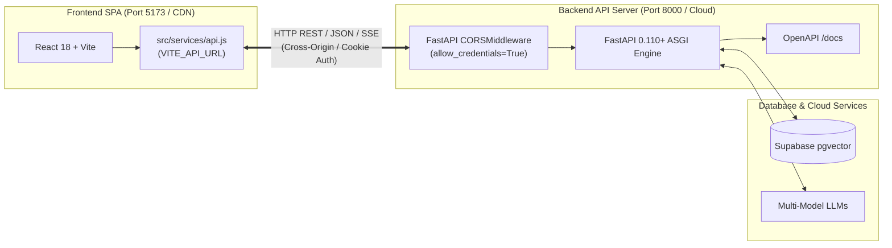

# 🪐 ChatSphare — Enterprise No-Code AI Agent Operating Platform

<div align="center">


</div>

---

## 📌 Project Title
**ChatSphare — Enterprise No-Code AI Agent Operating Platform**

---

## 📝 Short Description
ChatSphare is an autonomous no-code platform that crawls corporate websites, extracts brand identity, indexes organizational knowledge into high-dimensional vector embeddings, and deploys factually grounded AI customer support agents through a single line of embeddable code in under 60 seconds.

---

## 🎓 Project Type
**Internship Project under JSL Works**

---

## 🔍 Overview

### 🛑 Problem It Solves
1. **Manual Ingestion Fatigue:** Traditional RAG pipeline implementation requires weeks of custom scraper engineering, HTML sanitization, vector database indexing, and widget UI development.
2. **LLM Hallucinations & Commercial Liability:** Off-the-shelf chatbots invent non-existent pricing, quote fictitious return policies, and fabricate product specs, creating business and legal risks.
3. **Brand Visual Disconnect:** Standard chatbot solutions offer generic, unbranded popups that clash with the host website's primary colors, typography, and tone.
4. **Embedding Complexity:** Bulky JavaScript bundles and complex npm dependencies lead to library version conflicts, CSS bleeding, and performance drops on third-party host websites.

### 🎯 Main Purpose
To empower businesses, agencies, and webmasters to create and deploy an intelligent, factually grounded, and visually customized AI representative for their brand in **under 60 seconds**, simply by supplying their public website URL.

### 👥 Target Users
* **SMB & Business Owners:** Instant customer support automation, 24/7 lead capture, and zero technical staffing overhead.
* **E-Commerce Merchants:** Automated FAQ deflection, product catalog assistance, and checkout guidance.
* **Digital Agencies & Web Designers:** Rapid white-label chatbot creation and one-click client delivery.
* **SaaS & Tech Companies:** Interactive documentation search and Level-1 customer support deflection.

---

## 🌐 Architectural Approach: Decoupled Client-Server

ChatSphare follows a **Decoupled Architecture** where the **Frontend** and **Backend** run as separate, standalone applications that communicate strictly through asynchronous REST APIs:



* **Independent Development:** Frontend developers can build and test UI without Python dependencies. Backend engineers can build and test endpoints via Swagger (`/docs`) without Node.js.
* **Independent Deployment:** Frontend can be hosted on edge CDNs (Vercel, Netlify, Cloudflare), while Backend runs in Docker containers on serverless compute (AWS ECS Fargate, Render, Railway).
* **Strict API Boundary:** The frontend never connects to databases or manages AI keys directly; all data passes through authenticated backend endpoints.

---

## ✨ Key Features

* 🌐 **Autonomous Dual Scraping Engine:** Lightweight asynchronous `httpx` for ultra-fast static scraping (<300ms) with automatic fallback to headless `playwright` Chromium for dynamic, JavaScript-rendered SPAs (React, Vue, Angular).
* 🎨 **Automated Brand DNA Extraction:** Autonomously detects high-resolution logos, favicons, primary and secondary brand colors, font families, and company descriptions.
* 🧠 **Hybrid RAG Knowledge Grounding:** Chunks text and computes **1024-dimensional BGE-M3 vector embeddings** stored in Supabase PostgreSQL (`pgvector`) with HNSW cosine distance indexing (`vector_cosine_ops`).
* 🛡️ **9-Layer Organizational Knowledge Framework (OKF):** Strict anti-hallucination prompt architecture wrapping verified knowledge in rigid XML tags (`<verified_faq>`, `<knowledge_context>`), eliminating prompt injections and unauthorized answers.
* 🛠️ **3-Space Studio Workspace:**
  * **Edit Space:** Fine-tune bot personality, system instructions, and tool bindings.
  * **Test Space:** Live chat simulator displaying response latency, tokens consumed, and retrieved vector chunks.
  * **Deploy Space:** Instant copy-paste embed snippets and standalone URL generators.
* 📦 **Zero-Dependency Embed Widget:** Pure vanilla JavaScript client library (`/widget-embed.js`, <15KB) with scoped CSS, floating launcher bubble, and built-in lead capture forms.
* 🔐 **Enterprise Defense-in-Depth Security:** Backend-For-Frontend (BFF) session architecture with `HttpOnly`, `Secure`, `SameSite=Lax` cookies, Google RS256 JWKS token validation, and server-signed SVG anti-bot CAPTCHA protection.

---

## 🛠️ Tech Stack

### Frontend (Client)
* **Framework:** React 18.2 Single Page Application (SPA)
* **Build Tool:** Vite 5.4 with native ES modules and sub-second HMR
* **Routing:** React Router v7
* **Icons & Styling:** Lucide React (standardized 18px/20px glyphs) & custom CSS tokens
* **Authentication:** Firebase Client SDK v10 (Google Social Auth)
* **API Communication:** Decoupled HTTP client (`src/services/api.js`) targeting `VITE_API_URL`

### Backend (Server)
* **Web Framework:** FastAPI 0.110+ (Python 3.11)
* **ASGI Server:** Uvicorn with async event loop
* **Data Validation:** Pydantic v2 (Rust-backed core)
* **Web Scraping:** Asynchronous HTTPX 0.27+ & Playwright 1.42+ (Headless Chromium)
* **DOM Parsing:** BeautifulSoup4 & LXML
* **API Specification:** Automatic OpenAPI / Swagger UI at `/docs`

### Database & Search
* **Database:** Supabase PostgreSQL 15
* **Vector Engine:** `pgvector` extension
* **Embedding Model:** BGE-M3 (1024 dimensions)
* **Vector Index:** Hierarchical Navigable Small World (HNSW) with Cosine Distance (`vector_cosine_ops`, `m=16`, `ef_construction=64`)
* **Client Protocol:** PostgREST HTTP via `supabase-py`

### Other Important Tools & Services
* **AI Providers:** Multi-Model Cascading Failover (OpenRouter $\to$ Groq $\to$ Google Gemini $\to$ Mistral AI $\to$ OpenAI)
* **Authentication:** Firebase Admin SDK & Google Public JWKS (`RS256`)
* **Security:** ItsDangerous (HMAC signatures for SVG CAPTCHA), Custom Token-Bucket Rate Limiter
* **Containerization & Cloud:** Docker (multi-stage builds), AWS ECS Fargate (`ap-south-1`), Application Load Balancer (ALB), Vercel Edge

---

## 📁 Project Structure

```
chatsphare/
├── backend/                                  # Standalone FastAPI Backend Application
│   ├── app/
│   │   ├── core/                             # Core singletons: config, db factory, security, rate limiters
│   │   ├── models/                           # Pydantic v2 domain schemas and API contracts
│   │   ├── routers/                          # Modular API route controllers (/api/*)
│   │   ├── services/                         # Business logic services:
│   │   │   ├── agent/                        # Bot creation, Brand DNA extraction, setup commit
│   │   │   ├── auth/                         # BFF session cookie management, Google JWKS validation
│   │   │   ├── billing/                      # Credit allowance, promo code redemption
│   │   │   ├── knowledge/                    # Document ingestion (PDF, DOCX) & semantic chunking
│   │   │   ├── prompt/                       # 9-Layer OKF prompt hierarchy synthesis
│   │   │   ├── rag/                          # Embeddings computation & pgvector HNSW RPC query
│   │   │   ├── scraper/                      # Dual HTTPX / Playwright crawling engine
│   │   │   └── tools/                        # Interactive tool execution (Lead capture, webhooks)
│   │   └── static/                           # Embed widget runtime (/widget-embed.js) & standalone HTML
│   ├── migrations/                           # PostgreSQL SQL DDL schema & pgvector index migrations
│   └── tests/                                # Automated Pytest test suite
│
├── frontend/                                 # Standalone React 18 + Vite Frontend Application
│   ├── public/                               # Static assets, branding, and favicons
│   └── src/
│       ├── assets/                           # Vector SVG illustrations and icons
│       ├── components/                       # Shared UI layout primitives (Navbar, Sidebar, Modal)
│       │   ├── common/                       # Buttons, Inputs, Cards, Badges, Toast notifications
│       │   └── widget/                       # Embed widget preview components
│       ├── features/                         # Modular business domains:
│       │   ├── agents/                       # Bot management dashboard
│       │   ├── auth/                         # Login, signup, and CAPTCHA modals
│       │   ├── conversations/                # Conversation history & analytics
│       │   ├── knowledge/                    # Document upload & FAQ management
│       │   ├── landing/                      # Public marketing pages & pricing tiers
│       │   ├── studio/                       # Studio Workspace (Edit Space, Test Space, Deploy Space)
│       │   └── wizard/                       # 5-Stage Guided Creation Wizard (URL to Agent in 60s)
│       ├── lib/                              # Context providers (AuthContext, ThemeContext)
│       └── services/                         # Centralized API service client (BFF-aware fetch)
│
├── docs/                                     # Documentation
│   ├── 01-getting-started.md                 # Developer local environment setup guide
│   ├── 02-architecture-summary.md           # High-level architecture & data flow diagrams
│   └── OFFICIAL_PROJECT_DOCUMENTATION.md      # ⭐ Master 13-Section Engineering Charter (JSL Works)
│
├── .env.example                              # Comprehensive environment template with annotations
├── .gitignore                                # Production ignore rules (Python, Node, environment)
├── package.json                              # Root monorepo workspace scripts
├── README.md                                 # Master repository documentation (This file)
└── run.py                                    # Cross-platform development CLI orchestrator
```

---

## 🚀 Getting Started

### ⚙️ Prerequisites
Ensure the following tools are installed on your workstation:
* **Python:** `3.11` or higher
* **Node.js:** `18.x` or `20.x LTS` (with `npm`)
* **Supabase Project:** Active PostgreSQL 15 instance with the `vector` extension enabled
* **Firebase Project:** Web application configured with Google Authentication
* **LLM API Key:** Google Gemini, Mistral AI, Groq, or OpenRouter

---

### 📥 1. Clone & Setup Environment

```bash
# 1. Clone the repository and navigate to the project root
git clone https://github.com/Sayan-Official-32/ChatSphare.git
cd chatsphare

# 2. Configure environment variables
cp .env.example .env
```

---

### ⚡ 2. How to Run Frontend and Backend (Separately)

Because Frontend and Backend are decoupled, run each in its own terminal window:

#### 🖥️ Terminal 1: Run Backend (FastAPI)
```bash
cd backend

# Create and activate virtual environment
# Windows (PowerShell):
python -m venv .venv
.venv\Scripts\Activate.ps1

# Linux / macOS:
python3 -m venv .venv
source .venv/bin/activate

# Install backend dependencies
pip install -r requirements.txt

# Install Playwright browser binaries (one-time setup)
playwright install chromium

# Start Backend Server with auto-reload
uvicorn app.main:app --reload --host 127.0.0.1 --port 8000
```
* **Backend API:** `http://127.0.0.1:8000`
* **Swagger API Documentation:** `http://127.0.0.1:8000/docs`
* **Health Check Probe:** `http://127.0.0.1:8000/api/health`

---

#### 🌐 Terminal 2: Run Frontend (React + Vite)
```bash
cd frontend

# Install frontend dependencies (one-time setup)
npm install

# Start Vite Development Server
npm run dev
```
* **Frontend Portal:** `http://localhost:5173`
* The frontend connects automatically to the backend API at `http://127.0.0.1:8000/api`

---

> [!TIP]
> **Optional Convenience Runner:**  
> If you want to start both servers together in one terminal, run from the root:
> ```bash
> python run.py dev
> ```

---

## ⚙️ Environment Variables

The project requires specific environment variables for database connections, authentication verification, and LLM APIs.

1. Copy the provided `.env.example` file to create your local `.env`:
   ```bash
   cp .env.example .env
   ```
2. Open `.env` and fill in your keys:

```ini
# Supabase Configuration
SUPABASE_URL=https://your-project.supabase.co
SUPABASE_SERVICE_ROLE_KEY=your_service_role_key

# Firebase Authentication (BFF Session Verification)
FIREBASE_PROJECT_ID=your_firebase_project_id

# Primary LLM API Keys
GEMINI_API_KEY=your_gemini_api_key
MISTRAL_API_KEY=your_mistral_api_key
GROQ_API_KEY=your_groq_api_key

# Application Settings
ENVIRONMENT=development
PORT=8000
FRONTEND_URL=http://localhost:5173
SESSION_SECRET_KEY=generate_a_random_32_byte_secret_key
```

> [!IMPORTANT]
> Never commit your active `.env` file to source control. It is already included in `.gitignore`.

---

## 📚 Documentation Links

Detailed engineering specifications, architectural blueprints, and setup guides are available in the repository:

* 🏛️ **[Official Project Documentation & Engineering Charter](docs/OFFICIAL_PROJECT_DOCUMENTATION.md)** — Master 13-section specification, stakeholder RACI matrix, and MoSCoW prioritization.
* 🚀 **[Local Setup & Getting Started Guide](docs/01-getting-started.md)** — Step-by-step developer onboarding instructions.
* 🏗️ **[System Architecture Summary](docs/02-architecture-summary.md)** — 4-tier topology, security perimeter, and data flows.
* 📡 **[API Specifications & Endpoints](markdown/Codebase_And_Feature_Analysis.md#3-api-endpoints--service-interfaces)** — Complete REST API routing documentation.
* 🗄️ **[Database & Vector Search Schema](markdown/System_Architecture.md#5-database-architecture--vector-search)** — Supabase tables, indexes, and BGE-M3 embedding design.
* 📑 **[Consolidated Senior Engineering Report](markdown/Complete_Technical_Report.md)** — Full 360-degree technical assessment and implementation blueprint.

---

## 👥 Team Section

This project is conceived, architected, and engineered as part of the **JSL Works Internship Program**.

### 🎖️ Mentors
* **Partho Ghosh** — *Project Mentor & Technical Director*  
  Architectural oversight, system scalability, security governance, and code quality direction.
* **Priyanca Ghosh** — *Project Mentor & Delivery Lead*  
  Project management, agile roadmap delivery, milestone validation, and stakeholder alignment.

### 💻 Team Members (JSL Works Interns)
* **Sayan Paul** — *Full-Stack & Solutions Architecture Lead*  
  End-to-end system design, BFF session architecture, API contracts, core integration, and widget runtime.
* **Gulshan** — 
* **Keshav** — *Frontend & UI/UX Engineering Intern*  
  React 18 SPA, 5-Stage Creation Wizard, Studio workspace canvas, and responsive design.
* **Nitin** — 
* **Palak** — 
* **Sachin** — 
* **Sai Taj** — 

---

## 🤝 Contributing Guidelines

### 🌿 Branch Creation
* Always branch off the `develop` branch for new features and bug fixes.
* Branch naming:
  * `feature/<feature-name>` (e.g., `feature/brand-dna-picker`)
  * `bugfix/<bug-name>` (e.g., `bugfix/playwright-timeout`)
  * `hotfix/<issue-name>` (urgent fixes from `main`)

---

### 📝 Commit Message Style (Easy & Simple)

Keep your commit messages short, clear, and descriptive. Use one of these 4 prefixes:

* **`Add: <what you added>`** — for new features, files, or components
  * *Example:* `Add: web scraper fallback to Playwright`
  * *Example:* `Add: login modal component in frontend`
* **`Fix: <what you fixed>`** — for bug fixes or errors
  * *Example:* `Fix: session cookie expiration bug on logout`
  * *Example:* `Fix: mobile view layout for chat widget`
* **`Update: <what you changed>`** — for improving or modifying existing code
  * *Example:* `Update: database migration script for pgvector`
  * *Example:* `Update: API response format for agent list`
* **`Docs: <documentation changes>`** — for adding or editing docs
  * *Example:* `Docs: update README setup steps`
  * *Example:* `Docs: add API documentation link`

---

### 🔄 Pull Request Process
1. Push your branch to GitHub.
2. Open a Pull Request (PR) targeting the `develop` branch.
3. Write a 2-3 line summary of what was added or fixed.
4. Verify that your frontend or backend starts cleanly with no errors.
5. Request review from a teammate and get approval from a **Project Mentor** (**Partho Ghosh** or **Priyanca Ghosh**) before merging.

---

## 📄 License
**Internship Project under JSL Works** (All rights reserved).  
This codebase, its architecture, and associated documentation are proprietary assets of JSL Works. Unauthorized reproduction, modification, distribution, or commercial deployment without explicit written permission from JSL Works is strictly prohibited.

---

## 🙏 Acknowledgements
* Sincere thanks and gratitude to our project mentors, **Partho Ghosh** and **Priyanca Ghosh**, for their continuous technical guidance, code reviews, and mentorship throughout the duration of this project.
* Special thanks to **JSL Works** for sponsoring this internship opportunity and providing the cloud infrastructure, computational resources, and collaborative environment to bring ChatSphare to life.

---

<div align="center">
  <sub>Designed & Developed with ❤️ by the ChatSphare Team at <strong>JSL Works</strong>.</sub>
</div>
