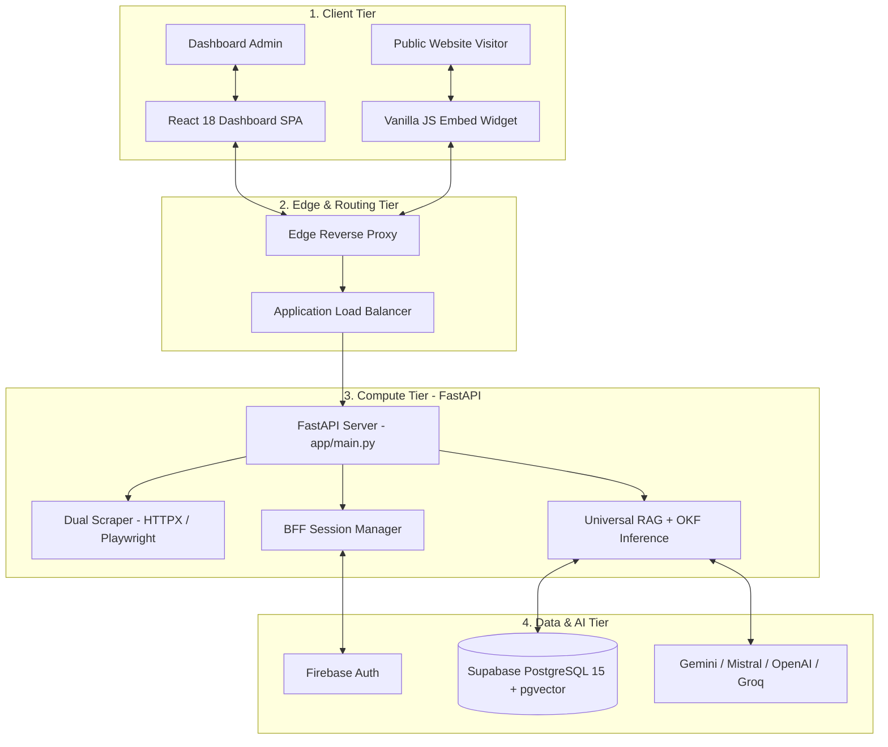

# 🏛️ ChatSphare: Architecture Summary & Key Concepts

> **Target Audience:** Engineers and architects seeking a concise overview of the ChatSphare platform topology.  
> **Source of Truth:** `chatsphare/markdown/System_Architecture.md`  

---

## 1. High-Level System Architecture

ChatSphare separates user interactions, edge routing, compute logic, and data storage into four decoupled tiers:

---

## 2. Core Architectural Highlights

### 2.1. Dual-Engine Web Scraping
* **HTTPX Engine:** Asynchronous fast-path crawling for static HTML sites (<300ms).
* **Playwright Chromium:** Headless browser rendering dynamically executed when client-side JavaScript hydration (React, Vue, Angular) or low text-density is detected.
* **HTML Normalizer:** Strips ads, scripts, layout chrome, and cookie banners to produce structured Markdown.

### 2.2. The 9-Layer Organizational Knowledge Framework (OKF)
System prompts are assembled in an immutable 9-layer hierarchical structure with strict XML containment to prevent prompt injection and eliminate hallucinations:
1. **Layer 1: Global Response Policy** (Strict anti-hallucination, highest precedence)
2. **Layer 2: Role Policy** (Customer Support, Sales, Technical, Brand Assistant)
3. **Layer 3: Stored Agent Instructions**
4. **Layer 4: Custom Brand Guidelines**
5. **Layer 4.5: Active Connectors & Tools** (Lead capture form)
6. **Layer 5: Brand Identity & Tone**
7. **Layer 6: `<verified_faq>`** (High-precision manual Q&A pairs)
8. **Layer 7: `<knowledge_context>`** (Retrieved vector chunks with heading breadcrumbs)
9. **Layer 8: `<conversation_context>`** (Multi-turn chat history)

### 2.3. Hybrid RAG & pgvector Indexing
* Documents are segmented using structure-aware semantic chunking (500–1200 characters) while preserving heading breadcrumbs (`[Pricing > Enterprise]`).
* 1024-dimensional dense vector embeddings are stored in Supabase PostgreSQL 15.
* HNSW graph indexing (`vector_cosine_ops`, `m=16`, `ef_construction=64`) delivers sub-10ms similarity search.

### 2.4. Zero-Dependency Embeddable Widget
* Pure vanilla JavaScript runtime (`/widget-embed.js`) weighing under 15KB minified.
* Injects an animated floating button and responsive chat window into any third-party host website via a single `<script>` tag.
* Scoped CSS prevents styling collisions with the host page.

### 2.5. Multi-Tenant Data Isolation
* **Level 1 (Workspace):** Partitioned by `user_id`.
* **Level 2 (Bot & Knowledge Base):** Partitioned by `agent_id`. Vector searches include hard SQL `WHERE agent_id = :target_id` filters.
* **Level 3 (Session):** Partitioned by `conversation_id` and `visitor_id`.
