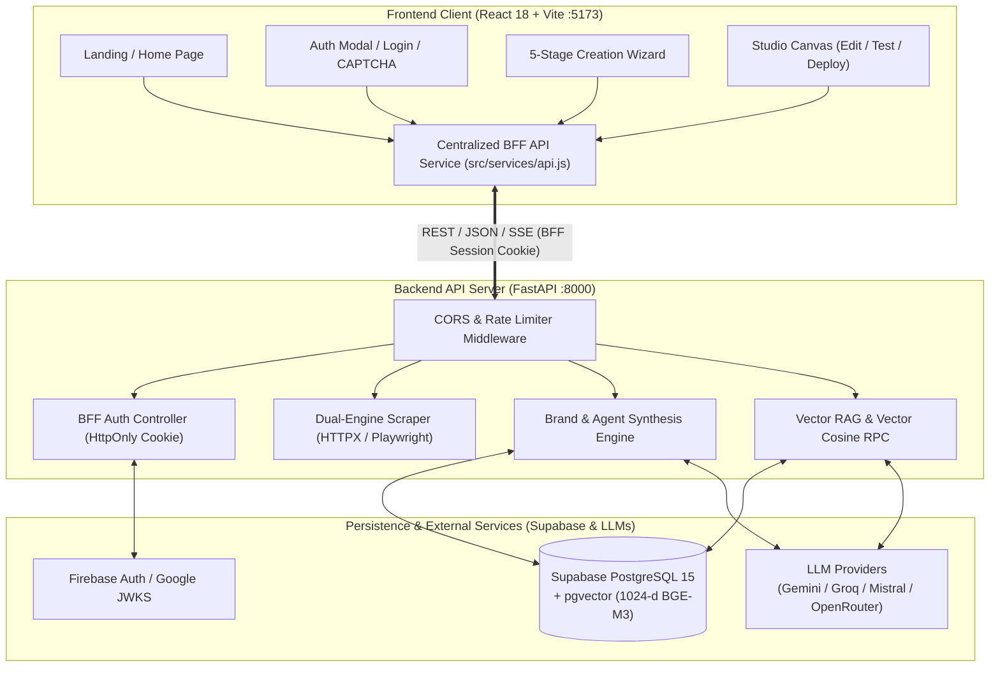
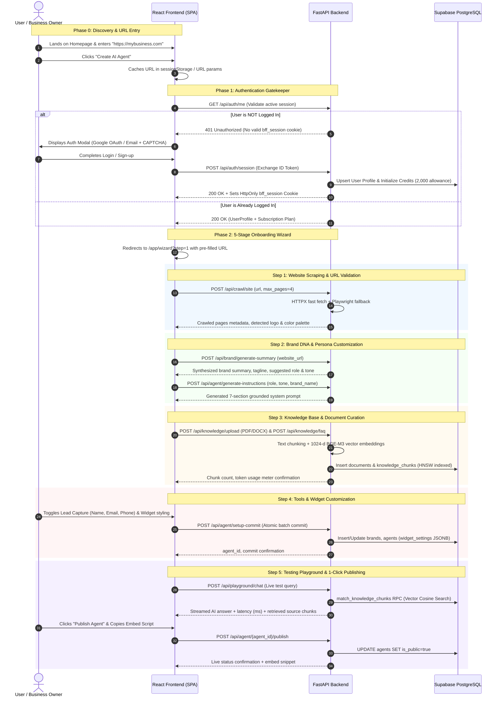

# 🪐 ChatSphare — System Architecture & End-to-End User Journey Specification

> **Document Type:** Initial System Architecture & Product Requirements Document (PRD)  
> **Author:** Senior Full-Stack Architect / Lead Developer  
> **Status:** Draft / Ready for Engineering Review  
> **Target Runtimes:** React 18 (Vite SPA) | FastAPI (Python 3.11+) | Supabase PostgreSQL 15 (`pgvector`) | Firebase Auth  

---

## 1. Executive Summary & Problem Statement

### 1.1. The Enterprise Problem
Modern businesses face four critical bottlenecks when attempting to deploy conversational AI on their web properties:

1. **Manual Ingestion & RAG Engineering Fatigue:** Building production-grade Retrieval-Augmented Generation (RAG) typically requires weeks of custom scraper engineering, HTML boilerplate cleaning, document chunking, vector embedding indexing, and UI widget development. Small-to-medium businesses and marketing agencies lack the dedicated machine learning engineering resources to build and maintain these pipelines.
2. **LLM Hallucinations & Commercial Liability:** Standard ungrounded LLM wrappers often invent non-existent discount codes, quote fictitious refund policies, and fabricate product capabilities—exposing companies to severe legal, financial, and reputational risk.
3. **Brand Identity & Visual Disconnect:** Generic off-the-shelf chatbots present mismatched, cookie-cutter popups that clash with the host website's primary colors, typography, brand tone, and design system.
4. **Integration & Bundle Overhead:** Complex client-side libraries that pull heavy dependencies cause CSS bleed, slow page-load times (impacting SEO scores), and require ongoing developer maintenance.

### 1.2. The ChatSphare Solution
**ChatSphare** solves this by offering an autonomous, zero-code AI agent operating platform. A business owner, webmaster, or agency client simply provides their public website URL. Within **60 seconds**, the platform:
- Crawls and sanitizes the target website.
- Autonomously extracts the brand's DNA (logo, favicon, color palette, font stack, and mission).
- Generates 1024-dimensional dense vector embeddings (`BGE-M3`) into Supabase `pgvector`.
- Synthesizes a factually grounded 9-Layer Organizational Knowledge Framework (OKF) system prompt.
- Provisions a production-ready, zero-dependency JavaScript widget (`<15KB`) ready for 1-click deployment.

---

## 2. High-Level Architecture & System Boundaries

ChatSphare is built on a **Decoupled Client-Server Architecture** ensuring independent scalability, security isolation, and rapid engineering iteration:



---

## 3. End-to-End User Flow Lifecycle



---

## 4. Detailed Page-by-Page Technical Specification

---

### Page 0: Landing / Home Page (`/`)

#### A. Frontend UI Elements & UX Components
* **Hero Section:**
  * High-converting headline: *"Deploy a Hallucination-Free AI Representative for Your Brand in Under 60 Seconds"*.
  * **Single URL Input Field:** High-contrast text input with pre-validation regex (`https?://[a-zA-Z0-9.-]+\.[a-zA-Z]{2,}`), placeholder `https://yourcompany.com`.
  * **Primary Action CTA:** Animated button `"Create Your AI Agent"`, displaying loading spinner upon submit.
* **Feature Highlights Grid:** Real-time visual comparison (ChatSphare vs. Generic LLM Wrappers).
* **Live Interactive Widget Demo:** Embedded floating widget pinned to bottom right of landing page allowing prospective users to test the agent immediately.
* **Pricing & Transparency Teaser:** Tier cards (Free, Explorer, Builder, Scale).
* **State Management:**
  * Reads/writes `draftUrl` into `sessionStorage` upon button click to prevent data loss across authentication redirects.

#### B. Backend API Contracts & Processing
* **Endpoint:** `GET /api/health`
  * **Purpose:** Initial system status check to verify API availability.
  * **Response:** `{"status": "healthy", "version": "1.0.0", "timestamp": "2026-11-15T12:00:00Z"}`.
* **Public Asset Endpoint:** `GET /widget-embed.js`
  * Delivers the minified (<15KB) vanilla JavaScript embed runtime for the homepage preview.

#### C. Database Storage & Schemas
* No database write occurs on the landing page for anonymous visitors.
* Ephemeral visitor metrics (anonymized IP hash, referrer header, user agent) are logged in memory/logs for rate limiting.

---

### Page 0.5: Authentication Gatekeeper & Session Modal

#### A. Frontend UI Elements & UX Components
* **Trigger Condition:** User submits a URL on the homepage or navigates to `/app/*` without an active session cookie.
* **Auth Modal / Split View Dialog:**
  * **Social Auth Button:** `"Continue with Google"` (Google OAuth via Firebase Client SDK).
  * **Email/Password Form:** Input fields for email and password, with client-side format validation.
  * **Anti-Bot Server-Signed Vector CAPTCHA:**
    * Displays dynamically fetched mathematical/visual SVG challenge.
    * Input field for user answer.
    * Refresh button to request a new challenge without full page reload.
  * **Switch Mode Toggle:** Instant tab toggle between `"Sign In"` and `"Create Account"`.
  * **Error Toast Banner:** High-visibility alerts for invalid credentials, expired CAPTCHAs, or rate limits.

#### B. Backend API Contracts & Processing
* **1. Issue CAPTCHA Challenge:**
  * `POST /api/auth/captcha`
  * **Logic:** Generates a random alphanumeric mathematical challenge, computes SVG paths, and signs payload with server secret (`HMAC-SHA256`) containing timestamp (5-minute expiration).
  * **Response Schema:**
    ```json
    {
      "captcha_id": "c7a8b9f0-1234-5678-90ab-cdef12345678",
      "svg": "<svg xmlns='http://www.w3.org/2000/svg' width='160' height='50'>...</svg>",
      "expires_in_seconds": 300
    }
    ```
* **2. Session Establishment (BFF Login):**
  * `POST /api/auth/session`
  * **Request Headers / Body:**
    ```json
    {
      "id_token": "eyJhbGciOiJSUzI1NiIsImtpZCI6...",
      "captcha_id": "c7a8b9f0-...",
      "captcha_solution": "42"
    }
    ```
  * **Logic:**
    1. Validates CAPTCHA HMAC signature and solution.
    2. Verifies Google/Firebase ID token against Google's public JWKS (`RS256`).
    3. Resolves user UUID and writes an encrypted, `HttpOnly`, `Secure`, `SameSite=Lax` session cookie named `bff_session`.
* **3. Current User Verification:**
  * `GET /api/auth/me`
  * **Logic:** Reads incoming `bff_session` cookie; returns user profile, plan tier, and credit balances.
  * **Status Codes:** `200 OK` (Authenticated) or `401 Unauthorized`.

#### C. Database Storage & Schemas
* **Table:** `public.users`
  * `id` (`UUID`, PK) — Firebase UID or generated UUID.
  * `email` (`TEXT`, UNIQUE, NOT NULL) — Verified email address.
  * `display_name` (`TEXT`) — User full name.
  * `photo_url` (`TEXT`) — Profile avatar image.
  * `auth_provider` (`TEXT`, default `'firebase'`) — Authentication method.
  * `plan_tier` (`TEXT`, default `'free'`) — Subscription tier.
  * `created_at` / `updated_at` (`TIMESTAMPTZ`).
* **Table:** `public.user_credits`
  * `user_id` (`UUID`, PK, FK $\to$ `users.id` ON DELETE CASCADE).
  * `plan_tier` (`TEXT`, `'free'`).
  * `monthly_allowance` (`INT`, `2000`).
  * `monthly_used` (`INT`, `0`).
  * `topup_credits` (`INT`, `0`).
  * `cycle_start` / `cycle_end` (`TIMESTAMPTZ`).

---

### Step 1: Website Scraping & URL Validation (`/app/wizard?step=1`)

#### A. Frontend UI Elements & UX Components
* **Breadcrumb Stepper Header:** 5-step numbered progress bar highlighting `Step 1: Website Scraping`.
* **URL Review Input Box:** Displays the URL passed from Homepage (editable in case user wants to change domain).
* **Crawl Depth Selector:**
  * Quick Crawl (Homepage only, ~5s).
  * Standard Crawl (Homepage + up to 4 key subpages: About, Pricing, Contact, FAQ, ~15s).
* **Animated Crawl Progress Monitor:**
  * Stepwise checklist:
    * `[✓] Resolving DNS & SSL handshake`
    * `[✓] Fast HTTPX DOM fetch (<300ms)`
    * `[✓] Playwright Chromium fallback (SPA rendering)`
    * `[✓] Stripping navigation, scripts, ads, and footers`
    * `[✓] Detecting Brand DNA, logo & color palette`
* **Discovered Pages Table:**
  * URL column, Page Title, Word Count, Status badge (`Success`, `Warning`).
  * Checkbox toggle for each page to include/exclude from final indexing.
* **Navigation Footer:** Disabled `"Previous"` button, Active `"Continue to Brand DNA"` button.

#### B. Backend API Contracts & Processing
* **Endpoint:** `POST /api/crawl/site` (or `POST /api/crawl`)
  * **Request Body:**
    ```json
    {
      "url": "https://example.com",
      "max_pages": 4,
      "follow_subdomains": false
    }
    ```
  * **Processing Pipeline:**
    1. **SSRF Guard:** Validates URL against private RFC-1918 IP addresses (`127.0.0.1`, `10.0.0.0/8`, `192.168.0.0/16`, AWS metadata `169.254.169.254`).
    2. **Dual-Engine Execution:** Fires asynchronous `httpx.AsyncClient` GET request with custom User-Agent. If page contains JavaScript SPA root tags (`<div id="root"></div>`) with zero body text, automatically spawns headless `playwright` Chromium worker.
    3. **DOM Cleaning:** Removes `<script>`, `<style>`, `<nav>`, `<footer>`, `<iframe>`, and SVG markup. Extracts clean markdown/text content.
    4. **Brand Asset Detection:** Extracts `<link rel="icon">`, OpenGraph image (`og:image`), CSS root variables (`--primary-color`), and `<title>` tag.
  * **Response Body:**
    ```json
    {
      "website_url": "https://example.com",
      "total_pages_crawled": 4,
      "detected_brand_name": "Example Corp",
      "detected_logo_url": "https://example.com/logo.png",
      "detected_colors": ["#6366f1", "#4f46e5", "#1e1b4b"],
      "extraction_duration_ms": 680,
      "pages": [
        {
          "url": "https://example.com",
          "title": "Example Corp — Modern Automation",
          "content": "...",
          "word_count": 480,
          "status": "success"
        }
      ]
    }
    ```
* **Draft Auto-Save:** `POST /api/agent/draft` stores state in memory/database to prevent loss if browser is refreshed.

#### C. Database Storage & Schemas
* In-flight state is preserved in `WizardDraft` session storage (`step = 1`, `website_url`, `selected_pages`).
* No permanent tables committed until Step 4/5 atomic setup commit, preventing orphan records if the user abandons the wizard.

---

### Step 2: Brand DNA & Persona Customization (`/app/wizard?step=2`)

#### A. Frontend UI Elements & UX Components
* **Brand Identity Review Card:**
  * **Brand Name:** Editable text input (pre-populated by crawler).
  * **Brand Logo & Favicon:** Dual preview cards with image thumbnail and `"Change Logo"` image upload dropzone / URL input.
  * **Color Palette Controls:**
    * Primary Color picker (Hex input + color swatch, default `#6366f1`).
    * Secondary Color picker (default `#4f46e5`).
    * Real-time preview pill showing contrast ratio.
  * **Font Family Dropdown:** Inter, Roboto, Plus Jakarta Sans, Open Sans, System Default.
* **Agent Persona & Role Selector:**
  * 4 Preset Cards with icon and description:
    1. *Customer Support Specialist* (Default) — Polite, resolving inquiries, deflecting tickets.
    2. *Sales & Lead Generation* — Inquisitive, qualifies prospects, books meetings.
    3. *Technical Documentation Expert* — Precise, quotes code snippets, strict citations.
    4. *Custom Persona* — Free-form description.
* **Brand Tone Chips:** Multi-select chips (*Professional*, *Friendly*, *Direct*, *Empathetic*).
* **AI System Prompt Synthesis Box:**
  * `"Generate Instructions with AI"` button.
  * Remaining Quota Badge (e.g., `5/5 AI generations remaining today`).
  * Live editable textarea containing synthesized 7-section prompt.
* **Live Widget Preview Sidebar:** A miniature chat widget preview updates in real-time as colors, names, and logos change.

#### B. Backend API Contracts & Processing
* **1. Brand Summary Generation:**
  * `POST /api/brand/generate-summary`
  * **Request:** `{"website_url": "https://example.com", "brand_name": "Example Corp"}`
  * **Logic:** Passes scraped text to LLM to generate brand mission, audience, tagline, and suggested role.
  * **Response:**
    ```json
    {
      "brand_name": "Example Corp",
      "tagline": "Modern Enterprise Automation Made Simple",
      "summary": "Example Corp specializes in end-to-end workflow automation...",
      "suggested_role": "Customer Support Specialist",
      "suggested_tone": "Professional & Helpful",
      "target_audience": "Mid-market IT & Operations Managers"
    }
    ```
* **2. Prompt Synthesis:**
  * `POST /api/agent/generate-instructions`
  * **Request:** `{"brand_name": "Example Corp", "role": "Customer Support Specialist", "tone": "Professional & Helpful"}`
  * **Quota Guard:** Decrements 24-hour rate limit (`InstructionsQuotaResponse`).
  * **Response:** `{"status": "success", "system_prompt": "..."}`
* **3. Sub-Session Snapshot:**
  * `POST /api/agent/sub-session` with `step: 2, data: { brand_dna, agent_config }`.

#### C. Database Storage & Schemas
* Stored in `WizardDraft.sub_sessions["step_2"]`.
* Prepared for insertion into `public.brands` and `public.agents`.

---

### Step 3: Knowledge Base & Document Curation (`/app/wizard?step=3`)

#### A. Frontend UI Elements & UX Components
* **Knowledge Source Tabs:**
  1. **Crawled Web Pages Tab:**
     * Table displaying all approved pages from Step 1.
     * Shows estimated tokens, character count, and preview button (opens modal with extracted raw text).
     * Action to delete or exclude individual pages.
  2. **File Upload Tab:**
     * Drag-and-drop file upload zone.
     * Supported formats: `.pdf`, `.docx`, `.txt`, `.csv` (Max 15MB per file).
     * Upload progress bar with real-time status (`Uploading` $\to$ `Extracting` $\to$ `Chunking` $\to$ `Vectorizing`).
  3. **Custom Q&A / FAQ Tab:**
     * Form with `"Question"` text input and `"Answer"` rich-text textarea.
     * `"+ Add FAQ Pair"` button.
     * List of existing FAQs with edit and delete actions.
* **Token & Knowledge Capacity Meter:**
  * Gauge bar displaying total tokens indexed vs. current plan limit (e.g., `18,450 / 100,000 tokens used`).
* **Navigation Buttons:** `"Back to Brand DNA"`, `"Continue to Tools"`.

#### B. Backend API Contracts & Processing
* **1. Multi-Format File Ingestion:**
  * `POST /api/knowledge/upload` (`multipart/form-data`)
  * **Logic:**
    * PDF parsing via `pypdf` / `pdfminer`.
    * DOCX parsing via `python-docx`.
    * Sanitizes text and extracts document title.
* **2. Semantic Chunking & Vector Computation:**
  * Splits documents using structure-aware semantic chunking (500–1200 characters) preserving heading hierarchy breadcrumbs (e.g. `[Pricing > Enterprise Plan]`).
  * Computes **1024-dimensional dense vector embeddings** using `BGE-M3`.
* **3. Manual FAQ Ingestion:**
  * `POST /api/knowledge/faq`
  * **Request:** `{"question": "What is your refund policy?", "answer": "We offer a 30-day money-back guarantee."}`
  * Formatted as high-priority verified Q&A documents.
* **4. Query Document List:**
  * `GET /api/knowledge/documents/{agent_id}`

#### C. Database Storage & Schemas
* **Table:** `public.documents`
  * `id` (`UUID`, PK)
  * `agent_id` (`UUID`, FK $\to$ `agents.id`)
  * `title` (`TEXT`) — e.g., `"Pricing & Plans"` or `"company_handbook.pdf"`.
  * `source_type` (`TEXT`) — `'web_crawl'`, `'pdf'`, `'docx'`, `'manual_faq'`.
  * `source_url` (`TEXT`, NULL for uploads)
  * `content` (`TEXT`) — Raw sanitized text content.
  * `character_count` (`INT`), `word_count` (`INT`), `token_count` (`INT`).
  * `created_at` (`TIMESTAMPTZ`).
* **Table:** `public.knowledge_chunks`
  * `id` (`UUID`, PK)
  * `document_id` (`UUID`, FK $\to$ `documents.id` ON DELETE CASCADE)
  * `agent_id` (`UUID`, FK $\to$ `agents.id` ON DELETE CASCADE)
  * `chunk_index` (`INT`)
  * `chunk_text` (`TEXT`, NOT NULL) — 500–1200 character chunk.
  * `raw_text` (`TEXT`)
  * `heading_hierarchy` (`TEXT[]`) — e.g. `['Features', 'Integrations']`.
  * `content_hash` (`TEXT`) — SHA-256 hash to prevent duplicate embedding.
  * `embedding` (`VECTOR(1024)`) — BGE-M3 dense representation.
  * **Index:** `idx_knowledge_chunks_embedding_hnsw` using `vector_cosine_ops` (`m = 16`, `ef_construction = 64`).

---

### Step 4: Interactive Tools & Widget Customization (`/app/wizard?step=4`)

#### A. Frontend UI Elements & UX Components
* **Two-Column Split Layout:**
  * **Left Column (Configuration & Tool Controls):**
    * **Interactive Tool 1: Lead Capture Form:**
      * Toggle switch (`Enable Lead Capture`).
      * Field toggles: Full Name (required), Business Email (required), Phone Number (optional).
      * Form Trigger Condition:
        * Radio 1: *At start of conversation*
        * Radio 2: *After 2 messages exchanged*
        * Radio 3: *When visitor requests human handoff / sales*
    * **Widget Customization Controls:**
      * Widget Position: Bottom Right / Bottom Left radio buttons.
      * Theme Mode: Light Mode / Dark Mode / Custom.
      * Chat Launcher Button: Text input (default `"Chat with us"`), icon selector (Chat bubble, Robot, Sparkles).
      * Welcome Greeting Message: Textarea (default: *"Hello! Welcome to Example Corp. How can I assist you today?"*).
      * Input Placeholder Text: Input (default: *"Type your message..."*).
      * Border Radius Slider: `8px` to `24px`.
  * **Right Column (Live Interactive Device Canvas):**
    * Realistic desktop and mobile browser mockups.
    * Interactive floating launcher button that expands into the custom styled chat box upon clicking.
    * Real-time rendering of primary color, logo, typography, and greeting message.
* **Navigation Action:** `"Back"`, `"Commit & Proceed to Final Step"` (Triggers backend atomic transaction).

#### B. Backend API Contracts & Processing
* **Atomic Batch Setup Commit:**
  * `POST /api/agent/setup-commit`
  * **Request Payload:**
    ```json
    {
      "website_url": "https://example.com",
      "brand": {
        "brand_name": "Example Corp",
        "primary_color": "#6366f1",
        "secondary_color": "#4f46e5",
        "logo_url": "https://example.com/logo.png",
        "font_family": "Inter"
      },
      "agent": {
        "display_name": "Example Support AI",
        "role": "Customer Support Specialist",
        "tone": "Professional & Helpful",
        "system_prompt": "...",
        "greeting_message": "Hello! How can I help you today?",
        "widget_settings": {
          "theme": "Light",
          "position": "Right",
          "placeholder": "Type your message...",
          "launcher_text": "Chat with us",
          "border_radius": 16
        }
      },
      "crawled_pages": [...],
      "uploaded_files": [...]
    }
    ```
  * **Processing Logic:**
    1. Executes within a single database transaction.
    2. Creates record in `public.brands` linked to `user_id`.
    3. Creates record in `public.agents` linked to `brand_id`.
    4. Finalizes document and chunk records to bind with `agent_id`.
    5. Clears ephemeral `WizardDraft` from cache.
  * **Response:**
    ```json
    {
      "status": "success",
      "agent_id": "c9e2b104-58a1-432a-bc91-817293a90182",
      "message": "Agent and Brand DNA successfully committed"
    }
    ```

#### C. Database Storage & Schemas
* **Table:** `public.brands`
  * `id` (`UUID`, PK, default `gen_random_uuid()`)
  * `user_id` (`UUID`, FK $\to$ `users.id`)
  * `brand_name` (`TEXT`, NOT NULL)
  * `website_url` (`TEXT`)
  * `canonical_domain` (`TEXT`)
  * `logo_url` (`TEXT`)
  * `favicon_url` (`TEXT`)
  * `primary_color` (`TEXT`, default `'#6366f1'`)
  * `secondary_color` (`TEXT`, default `'#4f46e5'`)
  * `font_family` (`TEXT`, default `'Inter'`)
  * `brand_description` (`TEXT`)
* **Table:** `public.agents`
  * `id` (`UUID`, PK)
  * `brand_id` (`UUID`, FK $\to$ `brands.id` ON DELETE CASCADE)
  * `display_name` (`TEXT`, NOT NULL)
  * `role` (`TEXT`)
  * `tone` (`TEXT`)
  * `system_prompt` (`TEXT`)
  * `greeting_message` (`TEXT`)
  * `widget_settings` (`JSONB`) — stores position, colors, launcher text, border radius.
  * `is_default` (`BOOLEAN`, true)
  * `is_public` (`BOOLEAN`, false until Step 5 publish)

---

### Step 5: Testing Playground & 1-Click Publishing (`/app/wizard?step=5`)

#### A. Frontend UI Elements & UX Components
* **Split-Screen Studio View:**
  * **Left Side: Interactive Testing Simulator (Playground):**
    * Full-fledged chat UI with conversational message history.
    * Suggested inquiry chips (e.g., *"What are your plans?"*, *"Where are you located?"*).
    * Input bar with Send button.
    * **RAG Diagnostic Telemetry Drawer:**
      * Response Latency badge (e.g., `⚡ 420ms`).
      * Model used badge (e.g., `gemini-1.5-flash`).
      * Token Consumption counter (e.g., `182 tokens`).
      * Expandable **Retrieved Vector Chunks** drawer showing exact citation text, document title, and cosine similarity score (e.g., `Cosine Score: 0.89`).
  * **Right Side: Deployment & Embed Code Hub:**
    * **Live Status Badge:** Displays `Draft` with animated pulse $\to$ transitions to `Active / Live` upon publishing.
    * **Embed Code Snippet Box:**
      * Syntax-highlighted HTML snippet:
        ```html
        <!-- ChatSphare Embed Code -->
        <script 
          src="https://chatsphare.com/widget-embed.js" 
          data-agent-id="c9e2b104-58a1-432a-bc91-817293a90182" 
          defer>
        </script>
        ```
      * One-click `"Copy to Clipboard"` button with visual copy confirmation.
    * **Standalone Public Link Box:**
      * Shareable direct URL (`https://chatsphare.com/chat/c9e2b104-...`) for email signatures or social media.
    * **Platform Integration Guides:** Tabs for HTML, React/Next.js, WordPress, and Shopify.
    * **Action Buttons:**
      * Primary CTA: `"Publish Agent Now"` (changes status to public).
      * Secondary CTA: `"Enter Full Studio Workspace"` (redirects to advanced Studio canvas).

#### B. Backend API Contracts & Processing
* **1. Interactive Test Query (RAG Inference):**
  * `POST /api/playground/chat`
  * **Request Payload:**
    ```json
    {
      "agent_id": "c9e2b104-58a1-432a-bc91-817293a90182",
      "message": "What is your refund policy?",
      "conversation_id": "optional-uuid"
    }
    ```
  * **Inference Pipeline:**
    1. Computes 1024-d embedding of the query message via `BGE-M3`.
    2. Executes PostgreSQL stored procedure `match_knowledge_chunks(query_embedding, agent_id, match_count=4, threshold=0.20)`.
    3. Assembles prompt using the 9-Layer Organizational Knowledge Framework (OKF) with strict XML boundary tags (`<verified_faq>`, `<knowledge_context>`).
    4. Dispatches prompt to primary LLM (Gemini 1.5 Flash / Groq / Mistral) with cascading failover.
    5. Deducts credit balance from `public.user_credits` (1 credit per query).
    6. Streams response tokens via Server-Sent Events (SSE) or returns JSON.
  * **Response Schema:**
    ```json
    {
      "reply": "We offer a 30-day money-back guarantee on all subscription plans...",
      "response_time_ms": 420,
      "tokens_consumed": 182,
      "model": "gemini-1.5-flash",
      "citations": [
        {
          "document_title": "Pricing & Policies",
          "chunk_id": "...",
          "similarity": 0.89,
          "snippet": "We offer a 30-day money-back guarantee..."
        }
      ]
    }
    ```
* **2. Agent Publishing:**
  * `POST /api/agent/{agent_id}/publish`
  * **Logic:** Updates `is_public = TRUE` on the agent record, clearing local and CDN caches.
  * **Response:** `{"status": "success", "is_public": true, "published_at": "..."}`.

#### C. Database Storage & Schemas
* **Table Updates:**
  * `public.agents`: `is_public` set to `TRUE`, `updated_at` updated.
* **Table:** `public.chat_conversations`
  * `id` (`UUID`, PK)
  * `agent_id` (`UUID`, FK $\to$ `agents.id`)
  * `visitor_id` (`TEXT`) — Unique visitor token stored in client `localStorage`.
  * `user_ip` (`TEXT`)
  * `browser` (`TEXT`)
  * `status` (`TEXT`, default `'active'`)
* **Table:** `public.chat_messages`
  * `id` (`UUID`, PK)
  * `conversation_id` (`UUID`, FK $\to$ `chat_conversations.id`)
  * `role` (`TEXT`, `'user'` or `'assistant'`)
  * `message` (`TEXT`)
  * `token_count` (`INT`)
  * `response_time` (`INT`, ms)
  * `citations` (`JSONB`)
* **Table:** `public.credit_transactions`
  * `id` (`UUID`, PK)
  * `user_id` (`UUID`, FK $\to$ `users.id`)
  * `agent_id` (`TEXT`)
  * `credits_deducted` (`INT`, e.g. `1`)
  * `action_type` (`TEXT`, `'playground_test_chat'`)
* **Table:** `public.leads` (Populated when visitor submits lead form in widget)
  * `id` (`UUID`, PK)
  * `agent_id` (`UUID`, FK $\to$ `agents.id`)
  * `conversation_id` (`UUID`, FK $\to$ `chat_conversations.id`)
  * `name` (`TEXT`), `email` (`TEXT`), `phone` (`TEXT`)
  * `custom_data` (`JSONB`)

---

## 5. Comprehensive Database Schema Reference Matrix

| Table Name | Primary Key | Key Foreign Keys | Purpose & Stored Information | Estimated Storage Volume |
| :--- | :--- | :--- | :--- | :--- |
| `public.users` | `id` (UUID) | None | Core user account, email, Google UID, plan tier, verification status | 1 record per registered user (~500 B) |
| `public.user_credits` | `user_id` (UUID) | $\to$ `users.id` | Monthly allowance (2k-300k), consumed credits, rollover top-ups | 1 record per user (~250 B) |
| `public.credit_transactions`| `id` (UUID) | $\to$ `users.id` | Audit log of every token deduction, LLM model used, timestamp | Hundreds to thousands per active user (~300 B) |
| `public.brands` | `id` (UUID) | $\to$ `users.id` | Extracted visual identity: logo URL, colors, font stack, summary | 1–5 records per user (~2 KB) |
| `public.agents` | `id` (UUID) | $\to$ `brands.id` | Bot configuration: role, tone, 9-layer prompt, widget settings JSONB | 1–10 records per user (~8 KB) |
| `public.documents` | `id` (UUID) | $\to$ `agents.id` | Crawled URLs, uploaded PDFs/DOCXs, custom FAQs, raw content | 5–50 records per agent (~50 KB - 5 MB) |
| `public.knowledge_chunks` | `id` (UUID) | $\to$ `documents.id`, `agents.id` | Chunk text (500–1200 chars) + **1024-d BGE-M3 vector embedding** | 50–1,000 chunks per agent (~4.5 KB per chunk with vector) |
| `public.chat_conversations`| `id` (UUID) | $\to$ `agents.id` | Visitor session metadata, visitor ID, IP address, status | Thousands per published bot (~300 B) |
| `public.chat_messages` | `id` (UUID) | $\to$ `chat_conversations.id` | Full transcript of user questions & assistant replies with citations | 2–20 messages per conversation (~1 KB) |
| `public.leads` | `id` (UUID) | $\to$ `agents.id`, `chat_conversations.id` | Captured sales leads: name, email, phone, qualification metadata | Variable based on visitor conversion (~500 B) |

---

## 6. Technical Recommendations & Next Milestones

1. **Frontend Implementation:** Complete the state machine in `frontend/src/features/wizard/BrandAgentWizard.jsx` matching the 5 steps documented above.
2. **Playwright Sandbox Optimization:** Ensure worker concurrency is restricted to max 2 concurrent browsers per node to avoid high memory usage on AWS ECS Fargate.
3. **Database Migration Verification:** Ensure `pgvector` HNSW index is generated with `vector_cosine_ops` (`m=16`, `ef_construction=64`) for sub-15ms vector retrieval.
4. **Draft Recovery:** Use the existing `/api/agent/draft` and `/api/agent/sub-session` endpoints so users can resume their onboarding flow at any step if they navigate away.
