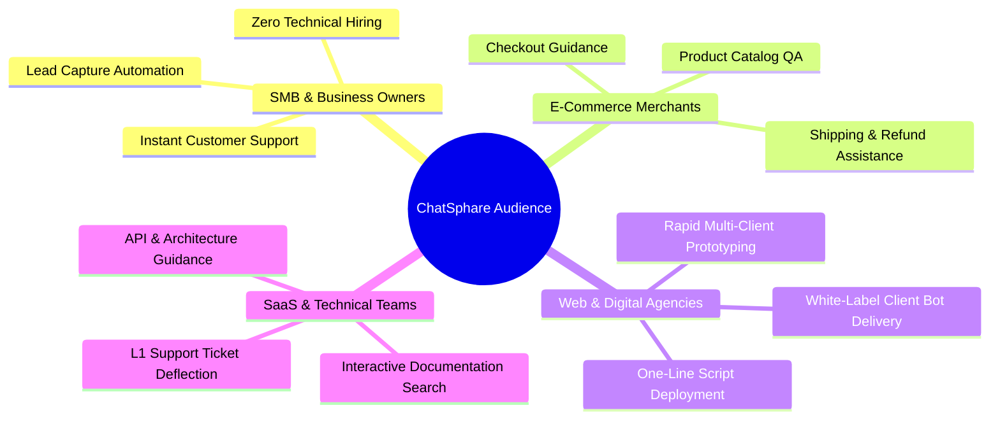
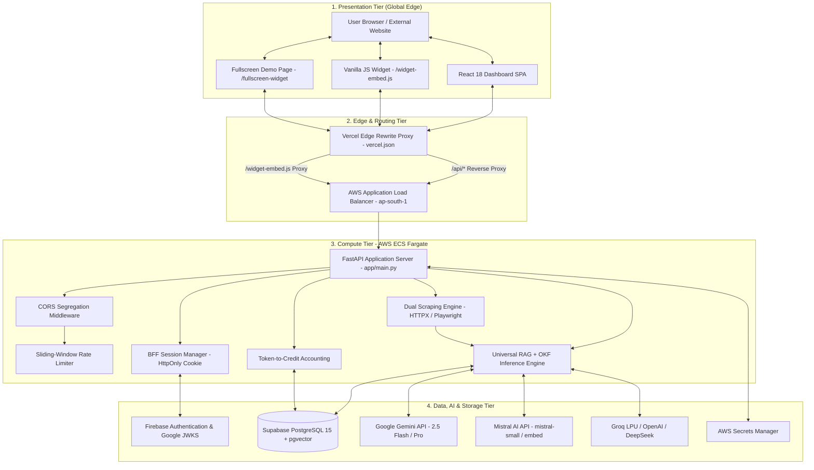
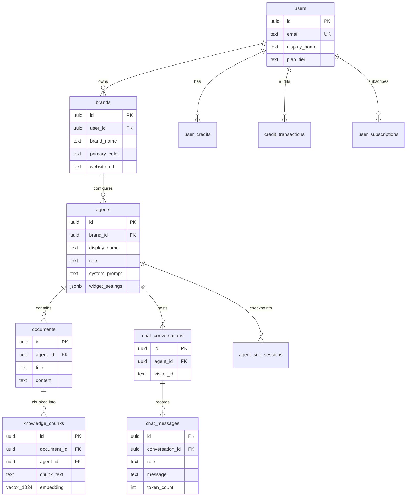

# 🏛️ ChatSphare: Official Initial Project Documentation & Engineering Charter

<div align="center">


**Turn any business website into an interactive, grounded, on-brand AI agent in seconds.**

*Authored for the JSL Works Internship Engineering Program*

</div>

---

## 📑 Document Control & Executive Summary

| Document Property | Specification Detail |
| :--- | :--- |
| **Project Title** | ChatSphare — Enterprise No-Code AI Agent Operating Platform |
| **Document Classification** | Official Initial Project Specification & Architecture Charter |
| **Authoring Body** | JSL Works Internship Engineering Team |
| **Project Mentors** | Partho Ghosh (Technical Director) & Priyanca Ghosh (Delivery Lead) |
| **Document Version** | `1.0.0-Official` |
| **Target Runtime** | Python 3.11+ / Node.js 18+ LTS / Supabase PostgreSQL 15 |
| **Target Infrastructure** | AWS ECS Fargate (`ap-south-1`) & Vercel Edge Network |
| **Status** | Approved & Baseline Established |

---

## 1. Project Basic Information

### 1.1. Project Name
**ChatSphare** (Internal System Identifier: `chatsphare`).

### 1.2. Short Project Description
> **ChatSphare** is an enterprise-grade No-Code AI Agent Operating Platform that autonomously crawls corporate websites, extracts visual brand identity, indexes unstructured organizational knowledge into high-dimensional vector embeddings, and deploys factually grounded conversational AI agents onto any website via zero-dependency embeddable JavaScript widgets.

### 1.3. Problem Statement
Deploying conversational AI in production is traditionally bottlenecked by four enterprise friction points:
1. **Manual Setup Fatigue:** Engineering a production RAG pipeline requires weeks of bespoke web crawler development, DOM parsing, semantic chunking, vector database provisioning, and widget UI construction.
2. **LLM Hallucinations & Commercial Liability:** Off-the-shelf LLMs frequently invent non-existent pricing tiers, quote fictional return policies, and fabricate product specifications, exposing businesses to serious commercial and legal liabilities.
3. **Brand Visual Fragmentation:** Most commercial chatbots provide generic, unbranded popups that clash with the host website's primary color palette, typography, and voice.
4. **Distribution & Embedding Friction:** Third-party website administrators resist integrating complex, heavyweight npm bundles that can cause library version conflicts or slow down page load times.

### 1.4. Main Goal of the Project
Enable any business—regardless of technical expertise—to transform their public website into a fully trained, visually cohesive, and factually grounded AI representative in **under 60 seconds**, deployable through a single line of vanilla HTML:
```html
<script src="https://chatsphare.app/widget-embed.js?agent_id=cs_..."></script>
```

### 1.5. Target Users & Audience Personas


---

## 2. Stakeholders & Team Structure (JSL Works)

This project is conceived, architected, and engineered as part of the **JSL Works Internship Program**.

### 2.1. Project Mentors & Technical Leadership
* **Partho Ghosh** — *Project Mentor & Technical Director*  
  Provides strategic technical leadership, architectural oversight, code quality governance, and production security auditing.
* **Priyanca Ghosh** — *Project Mentor & Delivery Lead*  
  Directs product roadmap execution, milestone delivery, agile sprints, stakeholder alignment, and operational readiness.

### 2.2. Development Team Structure (JSL Works Interns)
The student engineering team is organized into specialized functional roles:

| Team Member | Engineering Role | Primary Focus & Domain Ownership |
| :--- | :--- | :--- |
| **Sayan Paul** | Full-Stack & Solutions Architecture Lead | End-to-end system design, BFF session architecture, API contracts, core integration. |
| **Gulshan** | Backend & Systems Engineering Intern | FastAPI service layer, asynchronous endpoints, request middleware, exception handling. |
| **Keshav** | Frontend & UI/UX Engineering Intern | React 18 SPA, 5-Stage Creation Wizard, Studio workspace canvas, responsive UI. |
| **Nitin** | Database & Vector Search Intern | Supabase PostgreSQL schema, `pgvector` HNSW indexes, SQL migration scripts, PostgREST. |
| **Palak** | Quality Assurance & Product Operations Intern | End-to-end test suites, user journey verification, prompt safety audits, documentation. |
| **Sachin** | DevOps, Cloud Infrastructure & Security Intern | Docker multi-stage builds, AWS ECS Fargate, ALB routing, Secrets Manager, Vercel Edge. |
| **Sai Taj** | AI, Prompt Engineering & RAG Systems Intern | 9-Layer OKF prompt hierarchy, semantic chunking, multi-model cascading failover. |

### 2.3. RACI Responsibility Assignment Matrix

| Module / Milestone | Sayan | Gulshan | Keshav | Nitin | Palak | Sachin | Sai Taj | Mentors |
| :--- | :---: | :---: | :---: | :---: | :---: | :---: | :---: | :---: |
| **Architecture Charter & Documentation** | **A/R** | C | C | C | C | C | C | **I/A** |
| **Database & Vector Schema (pgvector)** | C | C | I | **A/R** | I | C | C | **A** |
| **FastAPI Backend Core & BFF Auth** | **A** | **R** | C | C | I | C | I | **A** |
| **Dual Crawler (HTTPX & Playwright)** | C | **A/R** | I | I | I | C | C | **A** |
| **9-Layer OKF & Multi-Model RAG** | C | C | I | C | I | I | **A/R** | **A** |
| **React 18 Frontend & Creation Wizard**| C | I | **A/R** | I | C | I | I | **A** |
| **Vanilla JS Embed Widget Runtime** | **A/R** | C | C | I | C | I | I | **A** |
| **Containerization & AWS Fargate** | C | I | I | I | I | **A/R** | I | **A** |
| **E2E Testing & Security Auditing** | C | C | C | C | **A/R** | C | C | **A** |

*(**R** = Responsible, **A** = Accountable, **C** = Consulted, **I** = Informed)*

---

## 3. Scope Definition

```
┌─────────────────────────────────────────────────────────────────────────────┐
│                           CHATSPHARE SCOPE BOUNDARY                         │
├──────────────────────────────────────┬──────────────────────────────────────┤
│              IN SCOPE (MVP)          │         OUT OF SCOPE (DEFERRED)      │
├──────────────────────────────────────┼──────────────────────────────────────┤
│ • 5-Stage Agent Creation Wizard      │ • Human agent live chat takeover     │
│ • Dual Web Scraper (HTTPX/Playwright)│ • Custom LLM pre-training/fine-tuning│
│ • Automated Brand DNA Extractor      │ • Native mobile apps (iOS/Android)   │
│ • Multi-format Document Ingestion    │ • Voice telephony / SIP trunking     │
│ • 1024-d BGE-M3 Vector Embeddings    │ • Direct credit card processing gate │
│ • 9-Layer OKF Prompt Safety Engine   │ • On-premise self-hosted air-gapping │
│ • Multi-Provider Cascading Failover  │ • WhatsApp / Telegram bot connectors │
│ • Vanilla JS Embeddable Web Widget   │ • Autonomous multi-agent workforces  │
│ • HttpOnly BFF Session Security      │ • Real-time voice speech synthesis   │
└──────────────────────────────────────┴──────────────────────────────────────┘
```

### 3.1. What is In Scope (MVP Must-Have Features)
1. **Automated Web Ingestion:** Dual-engine crawler crawling homepages and discovering internal subpages (`/about`, `/pricing`, `/services`).
2. **Brand DNA Extraction:** Autonomously extracting high-res logos, favicons, CSS primary/secondary color hexes, and typography.
3. **Structured Document Ingestion:** Parsing binary file uploads (PDF via PyMuPDF, Word `.docx`, PowerPoint `.pptx`) and manual FAQ pairs.
4. **Structure-Aware Semantic Chunking:** 500–1200 character text segmentation preserving Markdown heading breadcrumbs (`[Section > Subsection]`).
5. **Dense Vector Search:** 1024-dimensional vector embeddings stored in Supabase with HNSW cosine distance indexing (`vector_cosine_ops`).
6. **The 9-Layer OKF Prompt Architecture:** Rigid prompt assembly with XML delimiters neutralizing prompt injections and grounding responses.
7. **Multi-Model LLM Failover:** Resilient execution across Google Gemini, Mistral AI, Groq, OpenAI, and DeepSeek with an offline RAG fallback.
8. **Visual Studio Workspace:** Unified interface featuring Edit Space, Test Space (with latency and vector chunk telemetry), and Deploy Space.
9. **Zero-Code Embeddable Widget:** Self-contained vanilla JavaScript client (`/widget-embed.js`) and standalone fullscreen demo pages (`/fullscreen-widget/{agent_id}`).
10. **Enterprise Security & Auth:** Firebase Web SDK token exchange for HttpOnly BFF session cookies, server-signed vector SVG CAPTCHAs, and sliding-window rate limiting.
11. **Token Accounting & Billing Engine:** Credit deduction (1 credit / 100 weighted tokens) and database-driven promo code validation.

### 3.2. What is Out of Scope (Explicitly Excluded from Initial MVP)
1. **Human Agent Live Takeover:** Synchronous routing to human customer support desks (planned for Phase 2).
2. **Proprietary Model Fine-Tuning:** Training custom base LLM weights on private GPU clusters (RAG with prompt grounding satisfies requirements).
3. **Voice Telephony / SIP Trunking:** Automated phone calling or Twilio voice bridging.
4. **Native Mobile Applications:** Standalone iOS or Android native binaries (responsive web PWA and widget satisfy mobile needs).
5. **Direct Payment Gateway Processing:** Ingesting raw credit cards natively (uses promo code upgrade engine and third-party portal links).

---

## 4. Functional Requirements

### 4.1. Core System Modules
```
┌─────────────────────────────────────────────────────────────────────────────┐
│                           CHATSPHARE FUNCTIONAL MODULES                     │
├────────────────────────────┬────────────────────────────┬───────────────────┤
│ Module 1: Ingestion Engine │ Module 2: Intelligence RAG │ Module 3: Studio  │
│ - URL Domain Validator     │ - 9-Layer Prompt Compiler  │ - Edit Space      │
│ - Dual Fetcher (HTTPX/PW)  │ - OKF Identity Resolver    │ - Test Playground │
│ - 5-Stage HTML Normalizer  │ - HNSW Vector Search       │ - Deploy Snippets │
│ - Brand Asset Harvester    │ - Multi-LLM Cascading Fail │ - Widget Theming  │
├────────────────────────────┼────────────────────────────┼───────────────────┤
│ Module 4: Client Delivery  │ Module 5: Security & Auth  │ Module 6: Billing │
│ - Vanilla JS Embed Runtime │ - Firebase Token Verify    │ - Token Metering  │
│ - Scoped CSS Injector      │ - HttpOnly BFF Cookies     │ - Credit Deduct   │
│ - Fullscreen Demo Page     │ - Server SVG CAPTCHAs      │ - Promo Engine    │
│ - Lead Capture Form Tool   │ - Sliding-Window Limiter   │ - Quota Guard     │
└────────────────────────────┴────────────────────────────┴───────────────────┘
```

### 4.2. User Stories

#### Persona A: Website Visitor (End Customer)
* **US-01:** *As a website visitor, I want to ask questions in natural language so that I can instantly understand products, shipping policies, and pricing without searching through pages.*
* **US-02:** *As a website visitor, I want the chat assistant to quote accurate, verified information so that I never receive misleading advice or hallucinated discounts.*
* **US-03:** *As a website visitor, I want the chat widget to render cleanly on both mobile and desktop screens without obstructing page content.*
* **US-04:** *As a website visitor, I want to submit my contact information via an integrated lead form when requesting human follow-up.*

#### Persona B: Business Owner / Agent Creator (JSL Works Client)
* **US-05:** *As a business owner, I want to input my website URL and have an AI agent automatically created in under 60 seconds.*
* **US-06:** *As a business owner, I want the agent's colors, logo, and conversational tone to match my brand identity automatically.*
* **US-07:** *As a business owner, I want to upload internal company PDF and Word documents to train my agent on private operational knowledge.*
* **US-08:** *As a business owner, I want to test my agent in a real-time simulator before publishing it to my live website.*
* **US-09:** *As a business owner, I want a single `<script>` snippet that I can paste into Shopify or WordPress without technical assistance.*

#### Persona C: Platform Administrator
* **US-10:** *As an administrator, I want public chat endpoints protected by rate limiting and CAPTCHAs so malicious bots cannot exhaust LLM budgets.*
* **US-11:** *As an administrator, I want multi-tenant isolation ensuring that no user or bot can ever access another organization's documents.*

### 4.3. User Roles & Permissions Matrix

| Permission Capability | Guest Visitor | Free User | Paid Subscriber | Workspace Admin | System Superadmin |
| :--- | :---: | :---: | :---: | :---: | :---: |
| Query Public Embedded Widget | ✅ | ✅ | ✅ | ✅ | ✅ |
| Access Creation Wizard | ❌ | ✅ | ✅ | ✅ | ✅ |
| Maximum Created Bots | 0 | 1 Bot | Up to 10 Bots | Unlimited | Unlimited |
| Monthly Message Credits | 0 | 2,000 | 12k – 300k | Custom | Unlimited |
| Document Uploads (PDF/Word) | ❌ | Up to 5 MB | Up to 50 MB | Up to 500 MB | Unlimited |
| Advanced LLM Selection (Gemini Pro/GPT-4o)| ❌ | ❌ | ✅ | ✅ | ✅ |
| White-Labeling (Hide Branding)| ❌ | ❌ | ✅ | ✅ | ✅ |
| Database Migration Execution | ❌ | ❌ | ❌ | ❌ | ✅ |

### 4.4. Feature Prioritization (MoSCoW Matrix)
* **Must-Have (P0):** 5-Stage Wizard, Dual-Engine Crawler, Brand DNA extraction, 1024-d Vector Retrieval, 9-Layer OKF, Vanilla JS Widget, BFF Cookie Auth, Rate Limiter.
* **Should-Have (P1):** Multi-model failover queue, PDF/DOCX binary intake, subpage crawling, credit deduction auditing, standalone fullscreen demo pages.
* **Could-Have (P2):** Promo code redemption engine, SVG CAPTCHA generator, light/dark theme switching, custom instructions field.
* **Won't-Have-Yet (P3):** Live human agent chat takeover, voice SIP telephony, native iOS/Android apps, custom model fine-tuning.

---

## 5. Non-Functional Requirements (NFRs)

### 5.1. Performance & Latency Expectations
* **End-to-End Chat Latency:** P95 response time $\le 1.5$ seconds for conversational queries using fast models (`gemini-2.5-flash`).
* **Vector Similarity Retrieval:** Sub-10ms query execution in Supabase via HNSW graph indexing.
* **Static Page Crawling:** Extraction completed in under 300ms via asynchronous `httpx`.
* **Dynamic SPA Crawling:** Headless Playwright Chromium rendering completed within 8 seconds.
* **Embed Widget Footprint:** Minified bundle size $\le 15$ KB with zero external dependencies to prevent slowing down host website Core Web Vitals.

### 5.2. Security & Data Protection
* **Session Protection:** All dashboard sessions managed via `HttpOnly`, `Secure`, `SameSite=Lax` cookies (`bff_session`). Client-side scripts cannot access or exfiltrate session data.
* **Token Verification:** RS256 asymmetric cryptographic signature verification against Google's official public JWKS endpoint.
* **Prompt Injection Defense:** Strict XML containment (`<verified_faq>`, `<knowledge_context>`) ensuring untrusted user queries cannot override Layer 1 and Layer 2 system policies.
* **Denial-of-Service & Rate Limiting:** Enforces 30 requests/minute per client IP using a thread-safe sliding-window limiter.
* **Anti-Bot Defense:** Mathematical vector SVG CAPTCHAs signed with HMAC-SHA256 (`CAPTCHA_SECRET_KEY`) with 5-minute expirations.

### 5.3. Scalability & Availability
* **Stateless Compute:** Backend runs as stateless containers in AWS ECS Fargate, scaling horizontally behind an AWS Application Load Balancer without session stickiness issues.
* **Stateless Persistence:** Interacts with Supabase PostgreSQL over HTTPS via PostgREST (`supabase-py`), eliminating PostgreSQL connection pool exhaustion (port 5432) under sudden traffic spikes.
* **High Availability Target:** 99.9% uptime backed by automated multi-provider LLM failover.

### 5.4. Browser & Responsive Compatibility
* **Supported Desktop Browsers:** Chrome 100+, Safari 15+, Firefox 100+, Microsoft Edge 100+.
* **Supported Mobile Browsers:** Mobile Safari (iOS 15+), Chrome for Android.
* **Responsive Breakpoints:**
  * Mobile: $320\text{px} - 767\text{px}$ (Chat widget expands into full-screen responsive overlay).
  * Tablet: $768\text{px} - 1023\text{px}$.
  * Desktop: $1024\text{px} - 2560\text{px}$ (Floating drawer with 420px width and 600px height).

### 5.5. Regulatory Compliance & Data Ethics
* **GDPR & Privacy Readiness:** No tracking cookies injected into third-party visitor browsers. Clear user data deletion cascades (`ON DELETE CASCADE`) in database schemas.
* **Zero Secret Exposure:** Zero production keys or credentials committed to source control; all secrets managed via AWS Secrets Manager and `.env` files.

---

## 6. Technology Stack Decisions & Justifications

```
┌─────────────────────────────────────────────────────────────────────────────┐
│                          CHATSPHARE TECHNOLOGY STACK                        │
├─────────────────────┬─────────────────────────────────┬─────────────────────┤
│ Layer               │ Technology & Version            │ Primary Purpose     │
├─────────────────────┼─────────────────────────────────┼─────────────────────┤
│ Frontend Framework  │ React 18.2.0                    │ UI State Machines   │
│ Frontend Bundler    │ Vite 5.1.6                      │ Lightning Dev & HMR │
│ Client Routing      │ React Router DOM 7.18.2         │ Declarative Routing │
│ Iconography         │ Lucide React 0.344.0            │ Tree-Shakeable SVGs │
│ Client Auth         │ Firebase Web SDK 12.17.1        │ Google OAuth Client │
│ Embed Widget        │ Vanilla JavaScript (ES6+)       │ Zero-Dependency Embed│
│ Backend Framework   │ FastAPI >= 0.110.0              │ Asynchronous ASGI   │
│ ASGI Web Server     │ Uvicorn >= 0.28.0               │ High-Throughput Web │
│ Data Validation     │ Pydantic v2 >= 2.6.0            │ Type-Safe Schemas   │
│ Web Scraper (Fast)  │ Async HTTPX >= 0.27.0           │ Non-blocking Static │
│ Web Scraper (SPA)   │ Playwright Chromium >= 1.42.0   │ Headless Dynamic DOM│
│ DOM Parser & Sanit  │ BeautifulSoup4 >= 4.12.0 / LXML │ Markdown Conversion │
│ Document Intake     │ PyMuPDF (fitz) >= 1.24.0        │ Fast PDF Extraction │
│ Database & Vector   │ Supabase PostgreSQL 15 + pgvector│ Relational + Vectors│
│ Vector Indexing     │ HNSW (vector_cosine_ops)        │ Sub-10ms Cosine ANN │
│ Primary AI Engine   │ Google Gemini (2.5 Flash / Pro) │ Low-Latency Chat    │
│ Embedding Engine    │ Mistral AI (mistral-embed)      │ 1024-d Embeddings   │
│ Failover AI Engines │ Groq, OpenAI, DeepSeek, O-R     │ High-Availability   │
│ Cloud Compute       │ AWS ECS Fargate (ap-south-1)    │ Serverless Tasks    │
│ Traffic Routing     │ AWS Application Load Balancer   │ Health Probes & SSL │
│ Edge CDN & Proxy    │ Vercel Edge Network             │ Global CDN & Proxy  │
└─────────────────────┴─────────────────────────────────┴─────────────────────┘
```

### Key Architectural Justifications:
1. **Why FastAPI over Django/Flask?** FastAPI natively supports asynchronous Python (`async`/`await`) on ASGI, providing up to 300% higher throughput for I/O-bound LLM streaming and parallel web scraping while automatically generating OpenAPI documentation.
2. **Why React 18 + Vite over Next.js?** ChatSphare's administrative dashboard relies heavily on complex client-side state machines (color pickers, drag-and-drop file uploaders, live widget simulators). Vite provides sub-second HMR and compiles into static assets hosted globally on Vercel's CDN without requiring a Node server runtime.
3. **Why Supabase + `pgvector` over Pinecone/Weaviate?** Traditional architectures require paying for both a relational database (Postgres) and an external vector database (Pinecone), creating complex dual-write synchronization bugs. `pgvector` enables relational joins between `agents`, `documents`, and vector embeddings in a single ACID-compliant database.
4. **Why Playwright over Selenium?** Playwright natively integrates with the Python `asyncio` event loop, provides built-in auto-waiting for network idle states, and installs headless Chromium binaries reliably in Linux Docker containers.
5. **Why BFF HttpOnly Cookies over LocalStorage JWTs?** Storing access tokens in browser `localStorage` exposes user accounts to Cross-Site Scripting (XSS) exfiltration. The BFF cookie pattern guarantees that tokens cannot be read by client-side JavaScript.

---

## 7. High-Level Architecture & Component Design

### 7.1. Preferred Architectural Style
ChatSphare employs a **Decoupled Multi-Tier Hybrid Architecture** combining a static edge presentation layer, containerized micro-compute services on AWS ECS Fargate, and managed serverless database persistence on Supabase.

### 7.2. High-Level Component Topology


---

## 8. Database Architecture & Schema Specification



### Core Relational Tables:
1. **`public.users`:** Synchronized with Firebase UID (`id`), storing email, full name, and subscription tier (`plan_tier`).
2. **`public.brands`:** Stores extracted corporate branding (`brand_name`, `website_url`, `primary_color`, `secondary_color`, `font_family`, `brand_guidelines`).
3. **`public.agents`:** Defines bot identity (`display_name`, `role`, `tone`, `system_prompt`, `greeting_message`, `widget_settings`, `is_public`).
4. **`public.documents`:** Master records for crawled pages, uploaded files, and manual text entries.
5. **`public.knowledge_chunks`:** Stores 500–1200 character segments with heading breadcrumbs and 1024-dimensional dense vectors indexed with HNSW.
6. **`public.chat_conversations` & `public.chat_messages`:** Maintains conversation session isolation and audit trails.
7. **`public.user_credits` & `public.credit_transactions`:** Real-time token consumption metering and balance tracking.

---

## 9. API Expectations & Endpoint Contracts

The backend exposes a standardized RESTful JSON API documented via OpenAPI Swagger at `http://127.0.0.1:8000/docs`:

| HTTP Method | Route Endpoint | Security | Core Responsibility |
| :--- | :--- | :---: | :--- |
| `GET` | `/api/health` | Public | Container health probe returning version and status |
| `POST`| `/api/auth/session` | Public | Exchange Firebase ID token for HttpOnly `bff_session` cookie |
| `POST`| `/api/auth/logout` | Public | Invalidate and clear session cookie |
| `GET` | `/api/auth/me` | Public | Fetch current authenticated user profile (`authenticated: false` for guest) |
| `GET` | `/api/auth/captcha` | Public | Generate server-signed vector SVG CAPTCHA challenge |
| `POST`| `/api/auth/verify-captcha`| Public | Validate user solution against HMAC-signed token |
| `POST`| `/api/crawl` | Authenticated | Trigger 9-stage web crawling, DOM cleaning, and Brand DNA extraction |
| `GET` | `/api/agent/list` | Authenticated | List all isolated bots owned by current user |
| `POST`| `/api/agent/setup-commit` | Authenticated | Atomic batch commit of Steps 1, 2, 3/4 to Supabase |
| `POST`| `/api/agent/brand-config` | Authenticated | Update agent styling, prompt instructions, and tool bindings |
| `POST`| `/api/knowledge/upload-file`| Authenticated | Ingest binary document (PDF, DOCX, PPTX) into vector chunks |
| `POST`| `/api/playground/chat` | Authenticated | Studio testing simulator with live latency & token telemetry |
| `GET` | `/widget-embed.js` | Public | Serve zero-dependency vanilla JavaScript widget runtime |
| `GET` | `/fullscreen-widget/{id}`| Public | Serve standalone responsive fullscreen HTML chat page |
| `GET` | `/api/v1/bot/{id}/config`| Public | Public bot styling metadata (colors, avatar, suggestions) |
| `POST`| `/api/v1/bot/{id}/chat` | Public | Public rate-limited conversational RAG chat endpoint |
| `GET` | `/api/credits/balance` | Authenticated | Return real-time user credit allowance and usage |
| `POST`| `/api/subscription/apply-promocode`| Authenticated | Redeem promotional code and upgrade plan tier |

---

## 10. UI/UX Information & Design Standards

### 10.1. Visual Design Tokens
* **Theme Support:** Native Dark/Light mode toggle powered by custom CSS variables.
* **Palette:** Deep slate backgrounds (`#0f172a` dark / `#f8fafc` light), primary brand indigo/violet (`#7c3aed`), and vibrant accent gradients.
* **Card & Modal Geometry:** Rounded modern borders (`rounded-2xl` / `16px`), subtle borders (`rgba(255,255,255,0.08)`), and soft drop shadows.
* **Iconography:** Lucide React with standardized 18px and 20px glyphs.

### 10.2. Key User Journeys
1. **Creation Wizard Journey:**
   * Enter Website URL $\to$ Visual Scraper Progress Bar $\to$ Brand DNA Customizer $\to$ Document Review $\to$ Tool Activation $\to$ One-Click Publish.
2. **Studio Workspace Journey:**
   * Seamless tab switching between **Edit Space** (prompt engineering), **Test Space** (live RAG vector chunk inspection), and **Deploy Space** (copy-paste embed codes).
3. **External Website Visitor Journey:**
   * Visitor clicks floating launcher bubble $\to$ Widget opens with greeting and suggestion chips $\to$ Real-time grounded streaming responses $\to$ In-widget Lead Capture form.

---

## 11. Development Setup & Engineering Standards

### 11.1. Monorepo Organization
```
chatsphare/
├── backend/            # FastAPI ASGI server and services
├── frontend/           # React 18 + Vite frontend
├── docs/               # Quick-reference documentation
├── markdown/           # Complete 9-part architectural reference suite
├── .env.example        # Environment variable template
├── .gitignore          # Git ignore rules
├── package.json        # Workspace scripts
├── README.md           # Master documentation
└── run.py              # Cross-platform development runner
```

### 11.2. Python Engineering Standards
* Adhere strictly to **PEP 8** formatting guidelines.
* Enforce explicit type hinting on all function parameters and returns.
* Use Pydantic v2 models for all request/response serialization.
* Run non-blocking I/O via native `async`/`await`; offload blocking CPU operations via `asyncio.to_thread()`.

### 11.3. Frontend Engineering Standards
* Functional React components using hooks (`useState`, `useEffect`, `useCallback`, `useMemo`).
* Lazy code-splitting for all top-level routes using `React.lazy()` and `<Suspense>`.
* Centralized API communication through `src/services/api.js` (never raw `fetch` in UI components).

### 11.4. Git Branching Strategy
* `main`: Production-ready, deployed continuously to Vercel and AWS ECS Fargate.
* `develop`: Integration staging branch for completed features.
* `feature/<feature-name>`: Topic branches created by intern team members.
* `hotfix/<fix-name>`: Urgent production security and bug patches.

---

## 12. Risks, Constraints & Assumptions

### 12.1. Technical Risks & Failure Modes
* **Headless Browser Resource Exhaustion:** Playwright Chromium instances consume ~150–300MB RAM each.  
  *Mitigation:* Concurrency is capped via async semaphores, and crawling prioritizes lightweight HTTPX before falling back to Playwright.
* **Upstream LLM Rate Limits & Outages:** Cloud LLMs experience transient outages.  
  *Mitigation:* Cascading multi-provider failover automatically cycles through 6 distinct providers before executing a deterministic rule-based offline RAG fallback.
* **Gateway Timeouts during Deep Web Crawling:** Multi-subpage crawling can exceed standard HTTP request timeouts.  
  *Mitigation:* Subpage discovery is capped at 4 pages with an 8-second timeout per page.

### 12.2. Hardware & Resource Constraints
* AWS ECS Fargate task containers are provisioned with 1–2 vCPUs and 2–4 GB RAM.
* Vercel serverless edge rewrite proxy enforces a 10–30 second maximum request window.

### 12.3. Key Technical Assumptions
* Target crawled websites permit standard automated HTTP GET queries and do not deploy aggressive bot-blocking proof-of-work challenges.
* Host websites embedding `/widget-embed.js` support standard ES6 JavaScript and HTML5 custom elements.

---


*Officially endorsed by JSL Works Project Mentors Partho Ghosh & Priyanca Ghosh.*
