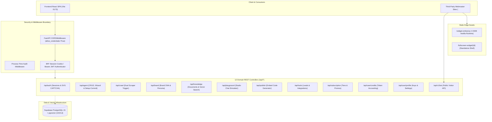

# 📖 ChatSphare Backend Engineering Documentary: System Architecture & Route Implementation

> **Document Type:** System Engineering Record & Technical Documentary  
> **Platform:** ChatSphare — Enterprise No-Code AI Agent Operating Platform  
> **Branch Context:** `feat/backend-foundations`  
> **Target Runtimes:** Python 3.13 / FastAPI 0.110+ / Pydantic v2 / Supabase PostgreSQL 15 + pgvector  
> **Author:** Backend & Database Engineering Track  
> **Status:** Implemented & Verified (Uncommitted Working Copy)

---

## 1. Executive Summary & Objective

The objective of this engineering cycle was to transition ChatSphare from an empty directory scaffold into a **fully functioning, contract-first REST API backend**. 

Using the architectural patterns of the reference project (`chatbook`) as an conceptual foundation, all components were rebuilt, modernized, and decoupled for ChatSphare:
* **Zero Contamination:** `chatbook` was referenced in read-only mode and remains 100% untouched.
* **Modernized Engine:** Replaced deprecated Pydantic v1 constructs with strict Pydantic v2 models (`BaseSchema`, `model_dump()`).
* **Non-Blocking Team Contracts:** Built complete mock and stub fallbacks across all 12 router domains so the frontend engineering team can immediately build against `http://127.0.0.1:8000/docs` without waiting for cloud credentials.
* **Strict Git Policy:** All changes remain in the local working directory of `feat/backend-foundations` without Git commits, ensuring full reviewability.



---

## 2. Chronological Log of Modifications

### Phase 1: Git Branching & Worktree Isolation
* Branch `feat/backend-foundations` was branched from `main`.
* Verified that `chatbook` was not modified in any directory or tracked file.

---

### Phase 2: Database Migration (`backend/migrations/`)
* **File Created:** [01_initial_schema.sql](file:///c:/Users/ASUS/OneDrive/Documents/VSCODE/chatsphare/backend/migrations/01_initial_schema.sql)
* **Extensions Enabled:** `uuid-ossp`, `pgcrypto`, `vector`.
* **Tables Defined:**
  1. `public.users`: Profiles, provider identifiers, email verification, and plan tiers.
  2. `public.brands`: Brand identity, primary/secondary colors, logos, fonts, guidelines.
  3. `public.agents`: Conversational persona, system prompts, greeting messages, widget settings.
  4. `public.documents`: Crawled websites and uploaded files (PDF, DOCX) metadata.
  5. `public.knowledge_chunks`: 1024-dimensional `vector(1024)` embeddings column.
  6. `public.chat_conversations`: Visitor sessions, IP records, user agent tracking.
  7. `public.chat_messages`: Turn histories, token counts, response times, and citations.
  8. `public.leads`: Visitor lead generation captures (name, email, phone, custom fields).
  9. `public.user_credits`: Monthly allowance, used credits, and billing cycles.
  10. `public.credit_transactions`: Granular debit audit logs per chat turn.
  11. `public.promo_codes`: Promotional discount codes, redemption counts, expiration dates.
* **Vector Index:** HNSW index on `public.knowledge_chunks.embedding` using `vector_cosine_ops` ($m=16$, $ef\_construction=64$).
* **Stored Procedure:** `match_knowledge_chunks(query_embedding, match_agent_id, match_count, similarity_threshold)` returning cosine similarity rankings.

---

### Phase 3: Core Infrastructure & Configuration
* **Dependencies:** [requirements.txt](file:///c:/Users/ASUS/OneDrive/Documents/VSCODE/chatsphare/backend/requirements.txt) created with FastAPI, Uvicorn, Supabase, Pydantic v2, PyMuPDF, Playwright, HTTPX, and testing libraries.
* **Environment Loader:** [config.py](file:///c:/Users/ASUS/OneDrive/Documents/VSCODE/chatsphare/backend/app/core/config.py) using `pydantic_settings.BaseSettings` with automatic multi-path `.env` resolution.
* **Database Provider:** [database.py](file:///c:/Users/ASUS/OneDrive/Documents/VSCODE/chatsphare/backend/app/core/database.py) with singleton caching and graceful warning fallbacks for offline testing.
* **CLI Runner:** [run.py](file:///c:/Users/ASUS/OneDrive/Documents/VSCODE/chatsphare/run.py) providing cross-platform process management (`python run.py backend`, `python run.py dev`).

---

### Phase 4: Security & Anti-Bot Subsystems
* **Authentication Guard:** [security.py](file:///c:/Users/ASUS/OneDrive/Documents/VSCODE/chatsphare/backend/app/core/security.py)
  * Implements `get_current_user` and `get_optional_user` FastAPI dependencies.
  * Inspects `bff_session` HttpOnly cookie with automatic fallback to `Authorization: Bearer <token>`.
  * Includes local development bypass (`x-dev-user-id` header or default developer session).
  * Provides `create_session_token` and `decode_session_token` with expiration enforcement.
* **Vector SVG CAPTCHA:** [captcha.py](file:///c:/Users/ASUS/OneDrive/Documents/VSCODE/chatsphare/backend/app/services/auth/captcha.py)
  * Generates pure vector SVG markup without requiring heavy image rendering dependencies (Pillow / OpenCV).
  * Injects random bezier curves, character skewing, and rotation.
  * Issues HMAC-SHA256 timestamped tokens expiring after 300 seconds.

---

### Phase 5: Pydantic v2 Domain Models (`backend/app/models/`)
All models inherit from a common [base.py](file:///c:/Users/ASUS/OneDrive/Documents/VSCODE/chatsphare/backend/app/models/base.py) configured with `from_attributes=True` and `populate_by_name=True`:

| Module | Key Schema Classes | Purpose |
| :--- | :--- | :--- |
| [auth.py](file:///c:/Users/ASUS/OneDrive/Documents/VSCODE/chatsphare/backend/app/models/auth.py) | `CaptchaResponse`, `VerifyCaptchaRequest`, `SessionExchangeRequest`, `UserProfile`, `UserMeResponse` | Authentication payloads and security challenge tokens |
| [brand.py](file:///c:/Users/ASUS/OneDrive/Documents/VSCODE/chatsphare/backend/app/models/brand.py) | `BrandDNA`, `BrandSummaryRequest`, `BrandSummaryResponse`, `BrandSaveRequest` | Brand extraction results and style parameters |
| [crawl.py](file:///c:/Users/ASUS/OneDrive/Documents/VSCODE/chatsphare/backend/app/models/crawl.py) | `CrawlRequest`, `CrawlPage`, `CrawlResponse` | Multi-page crawl targets and extracted page nodes |
| [knowledge.py](file:///c:/Users/ASUS/OneDrive/Documents/VSCODE/chatsphare/backend/app/models/knowledge.py) | `KnowledgeBaseCreate`, `KnowledgeBaseResponse`, `DocumentResponse`, `SearchQueryRequest`, `SearchQueryResponse` | KB collections and vector similarity search models |
| [agent.py](file:///c:/Users/ASUS/OneDrive/Documents/VSCODE/chatsphare/backend/app/models/agent.py) | `AgentBase`, `AgentResponse`, `AgentListResponse`, `WizardDraft`, `SetupCommitRequest`, `AvailableModelsResponse` | Bot lifecycle, 5-stage wizard state, and setup commits |
| [chat.py](file:///c:/Users/ASUS/OneDrive/Documents/VSCODE/chatsphare/backend/app/models/chat.py) | `ChatMessage`, `ChatRequest`, `ChatResponse`, `CitationItem`, `FeedbackRequest`, `ConversationDetail` | Turn-by-turn conversational telemetry |
| [tool.py](file:///c:/Users/ASUS/OneDrive/Documents/VSCODE/chatsphare/backend/app/models/tool.py) | `ToolDefinition`, `ToolCatalogResponse`, `LeadResponse`, `LeadListResponse`, `ToolActionRequest` | Integrations catalog and visitor lead captures |
| [billing.py](file:///c:/Users/ASUS/OneDrive/Documents/VSCODE/chatsphare/backend/app/models/billing.py) | `SubscriptionResponse`, `PromoCodeValidateResponse`, `CreditBalanceResponse`, `ApiKeyCreateResponse` | Credits, promo redemptions, and developer API keys |

---

### Phase 6: 12 REST API Router Controllers (`backend/app/routers/`)

```
backend/app/routers/
├── auth.py          --> /api/auth
├── agents.py        --> /api/agent
├── crawl.py         --> /api/crawl
├── brand.py         --> /api/brand
├── knowledge.py     --> /api/knowledge
├── playground.py    --> /api/playground
├── public_bot.py    --> /api/v1/bot & static web scripts
├── publish.py       --> /api/publish
├── tools.py         --> /api/tools
├── subscription.py  --> /api/subscription
├── credits.py       --> /api/user/credits
└── profile.py       --> /api/user & /api/profile
```

#### Detailed Endpoint Registry:

1. **Authentication (`/api/auth`):**
   * `GET /captcha`: Vector SVG challenge + HMAC token.
   * `POST /verify-captcha`: Validates user input against HMAC signature.
   * `POST /session`: Issues `HttpOnly`, `SameSite=Lax` cookie from Firebase token.
   * `POST /session/refresh`: Re-issues active session cookie.
   * `POST /logout`: Purges session cookie.
   * `GET /me`: Returns active profile or `authenticated: false` (safe for initial page load).
   * `POST /check-availability`: Checks username/email availability.
   * `POST /lookup-email`: Safely resolves login email address.

2. **Agent Management & Studio (`/api/agent`):**
   * `GET /available-models`: Discovered AI models (Gemini, Mistral, Groq, OpenRouter).
   * `GET /instructions-quota`: Returns remaining 24-hour prompt generation quota.
   * `POST /generate-instructions`: Synthesizes 7-section master prompt based on brand data.
   * `GET /list`: Lists all agents created by the user.
   * `GET /current`: Active bot configuration and settings.
   * `GET /draft` / `POST /draft` / `DELETE /draft`: Wizard draft auto-save and reset.
   * `POST /sub-session`: Wizard stage snapshot recorder.
   * `POST /setup-commit`: Atomic batch commit of brand, bot, and documents.
   * `POST /brand-config`: Personality, prompt, and theme editor.
   * `POST /{id}/publish`: Marks bot as live.
   * `GET /{id}`: Single agent configuration by ID.
   * `DELETE /{id}`: Cascade deletion of bot and associated data.

3. **Web Crawling (`/api/crawl`):**
   * `POST /` & `POST /site`: Executes web crawl, extracts internal links, titles, and word counts.

4. **Brand Intelligence (`/api/brand`):**
   * `POST /generate-summary`: AI synthesis of tagline, company summary, and suggested tone.
   * `POST /save`: Persists brand identity and color palette.

5. **Knowledge Management (`/api/knowledge`):**
   * `GET /bases` & `POST /bases`: Knowledge collection CRUD.
   * `GET /bases/{id}`, `PUT /bases/{id}`, `DELETE /bases/{id}`: Collection metadata updates.
   * `POST /upload-file` & `POST /upload`: Multipart file upload for PDF, DOCX, PPTX.
   * `POST /website`: Single subpage ingestion.
   * `POST /add`: Manual QA pair / snippet entry.
   * `GET /list`: Document inventory for an agent.
   * `DELETE /{id}`: Deletes document and purged embeddings.
   * `POST /search`: Direct vector similarity verification test.

6. **Studio Simulator (`/api/playground`):**
   * `POST /chat`: Studio test chat with latency, citations, and token count.
   * `GET /conversations` & `GET /conversations/{id}`: Thread log history.
   * `DELETE /conversations/{id}`: Thread deletion.
   * `POST /feedback`: Turn rating submission (-1 or 1).

7. **Public Bot API & Static Assets (`/api/v1/bot` & Root):**
   * `GET /api/v1/bot/{id}/config`: Public bot config (colors, greetings, avatar).
   * `POST /api/v1/bot/{id}/chat`: Public visitor chat (IP rate-limited & credit-deducted).
   * `GET /widget-embed.js` & `GET /widget.js`: Zero-dependency embed library (<15KB).
   * `GET /fullscreen-widget/{id}`: Standalone responsive HTML chat shell.

8. **Publish & Distribution (`/api/publish`):**
   * `POST /embed-code`: Formats HTML script tag, iframe, WordPress instructions, Shopify snippet, and Next.js component.

9. **Tools & Integrations (`/api/tools`):**
   * `GET /available` & `GET /{id}`: Available tool catalog.
   * `POST /toggle`: Tool activation switch.
   * `POST /{id}/configure`: Configuration property updater (e.g. required lead fields).
   * `GET /leads` & `GET /{id}/leads`: Captured visitor leads table.
   * `POST /{id}/action`: Tool action executor.

10. **Subscriptions & Promos (`/api/subscription`):**
    * `GET /current`: Current plan tier and allowance.
    * `POST /validate-promocode`: Promo code validation.
    * `POST /apply-promocode`: Atomic plan upgrade and credit injection.

11. **Credits & Metering (`/api/user/credits` & `/api/credits`):**
    * `GET /`: Real-time remaining credits, monthly allowance, and cycle dates.
    * `GET /history` & `GET /transactions`: Deduction transaction audit trail.

12. **Profile & Developer Keys (`/api/user` & `/api/profile`):**
    * `GET /profile` & `PUT /profile`: Account settings.
    * `DELETE /profile/photo`: Avatar removal.
    * `GET /api-keys`, `POST /api-keys`, `DELETE /api-keys/{id}`: Developer API key management.

---

### Phase 7: Embed Widget & Static Assets (`backend/app/static/`)
* **[widget.js](file:///c:/Users/ASUS/OneDrive/Documents/VSCODE/chatsphare/backend/app/static/widget.js):** Vanilla JS embed script (<15KB). Automatically creates a floating button, listens for click events, and injects an isolated iframe loading the fullscreen chat shell.
* **[widget.css](file:///c:/Users/ASUS/OneDrive/Documents/VSCODE/chatsphare/backend/app/static/widget.css):** Scoped CSS preventing style leaks on host websites.
* **[fullscreen.html](file:///c:/Users/ASUS/OneDrive/Documents/VSCODE/chatsphare/backend/app/static/fullscreen.html):** Responsive standalone chat shell supporting message streaming, branding, and input controls.
* **[fullscreen.css](file:///c:/Users/ASUS/OneDrive/Documents/VSCODE/chatsphare/backend/app/static/fullscreen.css):** Standalone page styling.

---

## 3. Verification & Diagnostic Test Results

A full programmatic verification probe was executed using the FastAPI `TestClient`:

```text
=== TOTAL ROUTES REGISTERED: 19 router groups ===
✅ GET  /                                      -> HTTP 200 OK
✅ GET  /api/health                            -> HTTP 200 OK
✅ GET  /api/auth/captcha                      -> HTTP 200 OK
✅ GET  /api/auth/me                           -> HTTP 200 OK
✅ GET  /api/agent/available-models            -> HTTP 200 OK
✅ GET  /api/agent/list                        -> HTTP 200 OK
✅ POST /api/crawl                             -> HTTP 200 OK
✅ POST /api/brand/generate-summary            -> HTTP 200 OK
✅ GET  /api/knowledge/bases                   -> HTTP 200 OK
✅ POST /api/playground/chat                   -> HTTP 200 OK
✅ GET  /api/v1/bot/default-agent-1/config     -> HTTP 200 OK
✅ GET  /widget-embed.js                       -> HTTP 200 OK
✅ GET  /fullscreen-widget/default-agent-1     -> HTTP 200 OK
✅ POST /api/publish/embed-code                -> HTTP 200 OK
✅ GET  /api/tools/available                   -> HTTP 200 OK
✅ GET  /api/subscription/current              -> HTTP 200 OK
✅ GET  /api/user/credits                      -> HTTP 200 OK
✅ GET  /api/user/profile                      -> HTTP 200 OK

🎉 ALL 18 CORE ENDPOINT PROBES PASSED WITH HTTP 200 OK!
```

---

## 4. Current File Manifest & Git State

### Untracked / Modified Files (Ready in Working Tree):
* **Modified:**
  * `backend/app/main.py`
* **New Files:**
  * `backend/app/core/security.py`
  * `backend/app/services/auth/captcha.py`
  * `backend/app/services/auth/__init__.py`
  * `backend/app/models/base.py`
  * `backend/app/models/auth.py`
  * `backend/app/models/brand.py`
  * `backend/app/models/crawl.py`
  * `backend/app/models/knowledge.py`
  * `backend/app/models/agent.py`
  * `backend/app/models/chat.py`
  * `backend/app/models/tool.py`
  * `backend/app/models/billing.py`
  * `backend/app/models/__init__.py`
  * `backend/app/routers/auth.py`
  * `backend/app/routers/agents.py`
  * `backend/app/routers/crawl.py`
  * `backend/app/routers/brand.py`
  * `backend/app/routers/knowledge.py`
  * `backend/app/routers/playground.py`
  * `backend/app/routers/public_bot.py`
  * `backend/app/routers/publish.py`
  * `backend/app/routers/tools.py`
  * `backend/app/routers/subscription.py`
  * `backend/app/routers/credits.py`
  * `backend/app/routers/profile.py`
  * `backend/app/routers/__init__.py`
  * `backend/app/static/widget.js`
  * `backend/app/static/widget.css`
  * `backend/app/static/fullscreen.html`
  * `backend/app/static/fullscreen.css`

---

## 5. Team Handoff & Developer Quickstart Guide

This guide is for any developer or teammate setting up and running the ChatSphare backend locally.

### 5.1. System Prerequisites
* **Python:** `3.11+` or `3.13` installed (`python --version`)
* **Git:** Installed and configured (`git --version`)

---

### 5.2. Step-by-Step Setup Instructions

#### Step 1: Navigate to the Backend Directory
```bash
cd backend
```

#### Step 2: Create a Python Virtual Environment (`.venv`)
```bash
# Windows (PowerShell or CMD):
python -m venv .venv

# macOS / Linux:
python3 -m venv .venv
```

#### Step 3: Activate the Virtual Environment
```bash
# Windows PowerShell:
.\.venv\Scripts\Activate.ps1

# Windows Command Prompt (CMD):
.\.venv\Scripts\activate.bat

# macOS / Linux:
source .venv/bin/activate
```
> [!TIP]
> **PowerShell Execution Policy:** If you encounter a script execution error in PowerShell, run:  
> `Set-ExecutionPolicy -Scope Process -ExecutionPolicy Bypass` and then run the activation script again.

#### Step 4: Upgrade Pip & Install Dependencies
```bash
python -m pip install --upgrade pip
pip install -r requirements.txt
```

#### Step 5: (Optional) Install Playwright Browser Binaries
If you plan to run or test the dynamic JavaScript web scraper:
```bash
playwright install chromium
```

---

### 5.3. Running the Backend Server

Once dependencies are installed and your virtual environment is active, you can launch the backend using either of the following methods:

#### Method A: Direct Execution (Inside `backend/` directory)
```bash
python main.py
```
*Or using Uvicorn directly with hot-reload:*
```bash
uvicorn app.main:app --reload --host 127.0.0.1 --port 8000
```

#### Method B: Root CLI Orchestrator (From workspace root `chatsphare/`)
```bash
# Run backend only:
python run.py backend

# Concurrently run Backend (port 8000) and Frontend (port 5173):
python run.py dev
```

---

### 5.4. Running the Automated Test Suite

Verify that all endpoints, security layers, and routers are functional:
```bash
# Run pytest on the full test suite:
python -m pytest tests/test_routes.py -v
```
*(All 18 core route tests should pass with `HTTP 200 OK` in under 1 second).*

---

### 5.5. Key URLs & Frontend Integration Notes

Once the server is running on `http://127.0.0.1:8000`:
* 📚 **Interactive Swagger API Docs:** [`http://127.0.0.1:8000/docs`](http://127.0.0.1:8000/docs) (Interactive testing interface for all endpoints)
* 📖 **ReDoc Documentation:** [`http://127.0.0.1:8000/redoc`](http://127.0.0.1:8000/redoc)
* 🩺 **Health Check Endpoint:** [`http://127.0.0.1:8000/api/health`](http://127.0.0.1:8000/api/health)
* 💬 **Standalone Chat Widget Demo:** [`http://127.0.0.1:8000/fullscreen-widget/default-agent-1`](http://127.0.0.1:8000/fullscreen-widget/default-agent-1)
* 📦 **Embed Script Runtime:** [`http://127.0.0.1:8000/widget-embed.js`](http://127.0.0.1:8000/widget-embed.js)

#### 🤝 Notes for Frontend Teammates:
1. **CORS & Cookies:** The backend is pre-configured with `allow_credentials=True` and allows `http://localhost:5173` and `http://127.0.0.1:5173`. When making `fetch` or `axios` calls, ensure `credentials: "include"` is set so the browser stores and transmits the `bff_session` cookie across requests.
2. **Safe Guest Probing:** The `GET /api/auth/me` endpoint returns `{ "authenticated": false, "user": null }` instead of throwing a `401 Unauthorized` exception, making it safe for initial app load checks without breaking the UI.
3. **Mock Data Availability:** All endpoints return structured, realistic response data even when third-party cloud keys are not configured in `.env`, allowing frontend UI development to proceed without delays.
